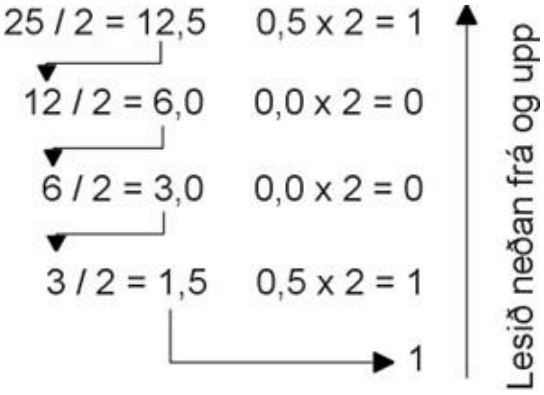
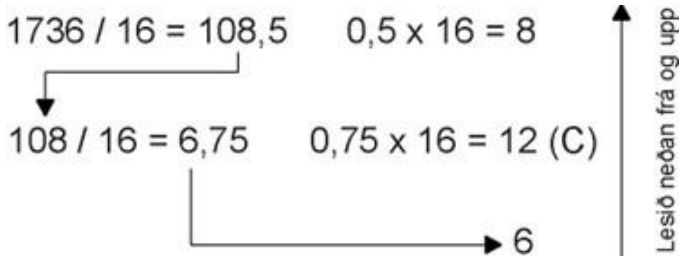
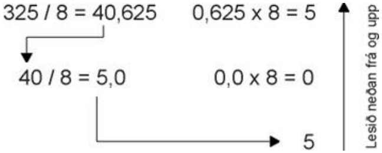

> Þetta hefti er án endurgjalds á rafbókinni [www.rafbok.is](https://www.rafbok.is). Allir rafiðnaðarmenn og rafiðnaðarnemar geta fengið aðgang að rafbókinni án endurgjalds.
>
> Heimilt er að afrita textann til fræðslu í skólum sem reknir eru fyrir opinbert fé án leyfis höfundar eða Rafmenntar, fræðsluseturs rafiðnaðarins. Hvers konar sala á textanum í heild eða að hluta til er óheimil nema að fengnu leyfi höfundar og Rafmenntar.
>
> Vinsamlegast sendið leiðréttingar og athugasemdir til höfundar eða til Báru Laxdal Halldórsdóttur á netfangið <bara@rafmennt.is>.
>
> Höfundur er Eiríkur Guðmundsson. Umbrot í rafbók: Bára Laxdal Halldórsdóttir.

## 1. Tugakerfið (decimal)

Rökrásir og öll lógík í rafmagnsfræði byggjast á tveimur stöðum. Það eru stöðurnar **lokuð straumrás** og **opin straumrás** eða **spenna og ekki spenna**. Til þess að lýsa þessu er notað talnakerfi sem hefur aðeins tvær stöður, 0 og 1, þar sem 0 táknar annaðhvort opna straumrás eða enga spennu og 1 táknar lokaða straumrás eða spennu. Þetta talnakerfi kallast tvíundarkerfi eða **binary numbers** á ensku.

Áður en við hættum okkur í tvíundarkerfið og önnur kerfi skulum við fyrst skoða talnakerfi almennt og uppbyggingu þeirra. Þá liggur beinast við að skoða fyrst það kerfi sem við þekkjum best, **tugakerfið**.

Eins og við vitum byggist tugakerfið upp á einingum, tugum, hundruðum, þúsundum o.s.frv. Skoðum einhverja venjulega tugakerfistölu og spáum í uppbyggingu hennar. Tökum sem dæmi töluna **325**. Við vitum að þetta eru **3** hundruð, **2** tugir og **5** einingar. Ef við köllum staðsetningu táknanna í tölunni *sæti* þá er talan **5** í sætinu lengst til hægri, sem ég kalla eftirleiðis 0. sæti, **2** er þá í 1. sæti og **3** í 2. sæti. Við sjáum að tugirnir, sem eru í 1. sæti, eru 10 sinnum stærri en einingarnar og hundruðin í 2. sæti eru 10 sinnum stærri en tugirnir. Munurinn á milli sæta er því alltaf tífaldur: 1, 10, 100, 1000, … og þess vegna heitir þetta **tuga**kerfi.

Nú skulum við skilgreina svokallaða margföldunarstuðla. Við segjum að 0. sætið hafi margföldunarstuðulinn 1 (eining), 1. sætið hefur margföldunarstuðulinn 10 (tugur), 2. sætið hefur margföldunarstuðulinn 100 (hundruð) og þannig koll af kolli. Ef við gerumst nú stærðfræðileg þá hefur 0. sætið stuðulinn $10^{0}$, 1. sætið stuðulinn $10^{1}$ og 2. sætið stuðulinn $10^{2}$. Nú er kerfið komið, þ.e. hvert sæti hefur margföldunarstuðulinn $10^{\text{númer sætis}}$. Athugið að tala í 0. veldi er alltaf 1, sama hver talan er, nema 0.

**Svona eru öll talnakerfi byggð upp.** Þau hafa öll ákveðna grunntölu sem þau eru nefnd eftir. Tugakerfið hefur grunntöluna **10**. Þau hafa öll ákveðinn fjölda tákna sem er sá sami og grunntalan. Tugakerfið hefur t.d. 10 tákn, tölurnar 0, 1, 2, 3, 4, 5, 6, 7, 8 og 9. Í hvert sæti má aðeins koma eitt tákn og í tugakerfinu er það einhver af tölunum 0 til 9. Táknið í sætinu margfaldast síðan með margföldunarstuðli sætisins.

Þetta hljómar flókið en svona eru öll talnakerfi byggð upp. Við erum orðin svo vön því að nota tugakerfið að við leiðum aldrei hugann að uppbyggingu þess. Ef við hins vegar áttum okkur á henni er lítið mál að læra ný talnakerfi.

### 1.1 Samantekt um tugakerfið

- Grunntala = 10
- Fjöldi tákna = 10 (0, 1, 2, 3, 4, 5, 6, 7, 8, 9)

**Uppbygging tugakerfisins (fjögur fyrstu sætin)**

| Sæti nr. | 3 | 2 | 1 | 0 |
|:--|:-:|:-:|:-:|:-:|
| **Margföldunarstuðull** | 1000 ($10^{3}$) | 100 ($10^{2}$) | 10 ($10^{1}$) | 1 ($10^{0}$) |

**Dæmi:**

$$
793 = 7\cdot 10^{2} + 9\cdot 10^{1} + 3\cdot 10^{0} = 7\cdot 100 + 9\cdot 10 + 3\cdot 1 = 700 + 90 + 3 = 793_{10}
$$

Fótskriftin $_{10}$ tilgreinir í hvaða talnakerfi við erum að vinna.

Tugakerfið hefur líka brothluta, þ.e. tölur aftan við kommu. Þær fylgja líka ákveðnu kerfi. Við tölum um $\tfrac{1}{10}$, $\tfrac{1}{100}$, $\tfrac{1}{1000}$ o.s.frv. Sjáum að nefnarinn stækkar tífalt eftir því sem við förum lengra til hægri. Það er vegna þess að við erum í talnakerfi með grunntöluna 10. Tölur vinstra megin við kommu stækka tífalt við hvert sæti en tölur hægra megin við kommu minnka tífalt við hvert sæti. Uppbyggingin lítur svona út:

| 1000 | 100 | 10 | 1 | , | 0,1 | 0,01 | 0,001 | 0,0001 |
|:-:|:-:|:-:|:-:|:-:|:-:|:-:|:-:|:-:|
| $10^{3}$ | $10^{2}$ | $10^{1}$ | $10^{0}$ | , | $10^{-1}$ | $10^{-2}$ | $10^{-3}$ | $10^{-4}$ |
| | | | | | $\frac{1}{10}$ | $\frac{1}{100}$ | $\frac{1}{1000}$ | $\frac{1}{10000}$ |

Talan 17,53 er því

$$
17{,}53 = 1\cdot 10 + 7\cdot 1 \;(+)\; 5\cdot 0{,}1 + 3\cdot 0{,}01
$$

þar sem $(+)$ táknar viðbótina aftan við kommu.

### 1.2 Tvíundarkerfið (binary)

Tvíundarkerfið hefur nákvæmlega sömu uppbyggingu og tugakerfið.

- Grunntala = 2
- Fjöldi tákna = 2 (0 og 1)
- 0\. sætið hefur margföldunarstuðulinn 1 (eins og reyndar í öllum talnakerfum),
- 1\. sætið hefur stuðulinn 2,
- 2\. sætið hefur stuðulinn 4,
- 3\. sætið hefur stuðulinn 8 o.s.frv.

**Gildið á milli sæta tvöfaldast:** 1, 2, 4, 8, 16, 32, 64, 128, 256, 512, 1024, …

**Uppbygging tvíundarkerfisins (fjögur fyrstu sætin)**

| Sæti nr. | 3 | 2 | 1 | 0 |
|:--|:-:|:-:|:-:|:-:|
| **Margföldunarstuðull** | 8 ($2^{3}$) | 4 ($2^{2}$) | 2 ($2^{1}$) | 1 ($2^{0}$) |

Hvert tákn kallast einn **biti** í tvíundarkerfi. Tala eins og 1011 kallast fjögurra bita tala.

Skoðum tvíundarkerfistöluna $1101_{2}$. Hér eftir nota ég fótskrift (*subscript*) til þess að tákna talnakerfið sem talan er skrifuð í. Fótskriftin $_{2}$ þýðir þá tvíundarkerfi.

| Sæti nr. | 3 | 2 | 1 | 0 |
|:--|:-:|:-:|:-:|:-:|
| **Tala** | **1** | **1** | **0** | **1** |
| **Margföldunarstuðull** | 8 ($2^{3}$) | 4 ($2^{2}$) | 2 ($2^{1}$) | 1 ($2^{0}$) |

Ef við umbreytum nú tvíundarkerfistölunni $1101_{2}$ í tugakerfistölu verður útkoman:

$$
1\cdot 8 + 1\cdot 4 + 0\cdot 2 + 1\cdot 1 = 8 + 4 + 0 + 1 = 13_{10}
$$

Við höfum því fundið leið til þess að geyma tugakerfistöluna 13 sem runu af 0 og 1, eða sem rununa: spenna – spenna – ekki spenna – spenna = 1101.

**Á þessu byggist tölvutæknin og öll stafræn tækni.**

Sjáum líka að allar oddatölur í tvíundarkerfi enda á 1 og sléttar tölur á 0 því aftasta sætið er eina sætið sem hefur oddatölu (1) sem margföldunarstuðul.

Hvernig getum við vitað fyrir fram hve marga bita við þurfum til þess að tákna einhverja ákveðna tugakerfistölu?

Með einum bita getum við bara táknað 0 og 1. Stærsta tala sem við getum táknað með tveimur bitum er talan 11 sem jafngildir 3 í tugakerfi, stærsta þriggja bita talan er 111 sem jafngildir 7 í tugakerfi. Ef þessar tugakerfistölur eru bornar saman við margföldunarstuðla tvíundarkerfisins sést að þær eru jafnar næsta margföldunarstuðli fyrir ofan, mínus 1. Út frá þessu kemur regla:

> Stærsta tugakerfistala sem hægt er að skrifa með $n$ bitum er $2^{n} - 1$.

**Dæmi:** Hver er stærsta tala sem hægt er að skrifa með 8 bitum?

$$
2^{8} - 1 = 256 - 1 = 255
$$

8 bitar (1 bæti) geta því táknað 256 ólíkar stöður (0 til 255 eða 00000000 til 11111111).

Eins og í tugakerfinu eru líka til kommutölur í tvíundarkerfinu. Þær fylgja nákvæmlega sömu reglum og í tugakerfinu. Tölur vinstra megin við kommu tvöfaldast við hvert sæti en tölur hægra megin við kommu minnka um helming við hvert sæti. Uppbyggingin er þessi:

| 8 | 4 | 2 | 1 | , | 0,5 | 0,25 | 0,125 | 0,0625 |
|:-:|:-:|:-:|:-:|:-:|:-:|:-:|:-:|:-:|
| $2^{3}$ | $2^{2}$ | $2^{1}$ | $2^{0}$ | , | $2^{-1}$ | $2^{-2}$ | $2^{-3}$ | $2^{-4}$ |
| | | | | | $\frac{1}{2}$ | $\frac{1}{4}$ | $\frac{1}{8}$ | $\frac{1}{16}$ |

Talan $1011{,}1010_{2}$ er því:

$$
1\cdot 8 + 0\cdot 4 + 1\cdot 2 + 1\cdot 1 \;(+)\; 1\cdot 0{,}5 + 0\cdot 0{,}25 + 1\cdot 0{,}125 + 0\cdot 0{,}0625 = 11{,}625_{10}
$$

þar sem $(+)$ táknar viðbótina aftan við kommu.

### 1.3 Sextándukerfið (hexadecimal)

Síðasta talnakerfið sem við skoðum er sextándukerfið. Það er hannað í kringum tvíundarkerfið og notað til þess að birta fjögurra bita tvíundartölu með einu tákni. En tugakerfið hefur bara 10 tákn og sextándukerfið þarf 16 tákn. Við verðum því að grípa til þess að fá að láni sex bókstafi, stafina A, B, C, D, E og F.

Sextándukerfistala getur því verið sambland af tölustöfum og bókstöfum. A táknar þá 10, B = 11, C = 12, D = 13, E = 14 og F = 15.

Eins og venjulega hefur 0. sætið margföldunarstuðulinn 1. Grunntalan er 16 svo að 1. sætið hefur margföldunarstuðulinn 16, 2. sætið stuðulinn $16^{2} = 256$ o.s.frv. Margföldunarstuðlarnir **sextánfaldast** á milli sæta: 1, 16, 256, 4096, …

Tökum sem dæmi sextándukerfistöluna $\mathrm{13AC}_{16}$.

| Sæti nr. | 3 | 2 | 1 | 0 |
|:--|:-:|:-:|:-:|:-:|
| **Tala** | 1 | 3 | A | C |
| **Margföldunarstuðull** | 4096 ($16^{3}$) | 256 ($16^{2}$) | 16 ($16^{1}$) | 1 ($16^{0}$) |

$$
\begin{aligned}
\mathrm{13AC}_{16} &= 1\cdot 4096 + 3\cdot 256 + \mathrm{A}\,(10)\cdot 16 + \mathrm{C}\,(12)\cdot 1 \\
&= 1\cdot 4096 + 3\cdot 256 + 10\cdot 16 + 12\cdot 1 \\
&= 4096 + 768 + 160 + 12 = 5036_{10}
\end{aligned}
$$

Við eigum eftir að sjá síðar að það er mjög þægilegt að breyta á milli tvíundarkerfis og sextándukerfis. Eina kerfið sem veldur okkur vandræðum er tugakerfið.

Sextándukerfið hefur líka kommutölur eins og tugakerfið og tvíundarkerfið. Það er líka byggt eins upp. Tölur vinstra megin við kommu sextánfaldast við hvert sæti en tölur hægra megin við kommu minnka sextánfalt við hvert sæti.

**Sextán fyrstu tölurnar í þremur talnakerfum**

| Tugakerfi | Tvíundarkerfi | Sextándukerfi |
|:-:|:-:|:-:|
| 0 | 0000 | 0 |
| 1 | 0001 | 1 |
| 2 | 0010 | 2 |
| 3 | 0011 | 3 |
| 4 | 0100 | 4 |
| 5 | 0101 | 5 |
| 6 | 0110 | 6 |
| 7 | 0111 | 7 |
| 8 | 1000 | 8 |
| 9 | 1001 | 9 |
| 10 | 1010 | A |
| 11 | 1011 | B |
| 12 | 1100 | C |
| 13 | 1101 | D |
| 14 | 1110 | E |
| 15 | 1111 | F |

### 1.4 Farið á milli talnakerfa

Það er nauðsynlegt að kunna að umreikna á milli talnakerfa. Yfirleitt er þetta ekkert mál nema þegar tugakerfið kemur við sögu. Við skulum byrja á því að skoða hvernig við breytum úr og í tugakerfi.

#### Úr tugakerfi í tvíundarkerfi

Hér er hægt að nota tvær aðferðir. Í fyrsta lagi ágiskunaraðferðina (raðað í sæti) þegar um litlar tölur er að ræða. Þá reynum við að mynda summu úr margföldunarstuðlum tvíundarkerfisins.

**Tökum dæmi:** Við ætlum að tákna tugakerfistöluna 25 í tvíundarkerfi. Við sjáum að $25 = 16 + 8 + 0 + 0 + 1$. Af þessu leiðir að $25_{10} = 11001_{2}$.

Sú aðferð sem meira er notuð, því hún hefur þann kost að virka alltaf, líka fyrir stórar tölur, auk þess sem hún er forritanleg, er endurtekin deiling með 2.

Hún virkar þannig að við deilum tugakerfistölunni með 2. Við fáum þá heiltölu fyrir framan kommu og brothluta fyrir aftan kommu. Þessi brothluti er alltaf 0,0 eða 0,5. Við tökum brothlutann og margföldum hann með 2 og fáum þá annaðhvort 0 eða 1. Heiltöluhlutinn færist niður og aftur er deilt með 2. Þessu höldum við áfram þangað til heiltalan er 1 en þá færist hún sjálfkrafa niður enda ekki hægt að deila 1 með 2. Þetta er auðveldara að skýra með dæmi.

Breytum $25_{10}$ í tvíundarkerfistölu:

*Mynd 1: Endurtekin deiling með 2. Útkoman er lesin neðan frá og upp.*

Útkoman er síðan lesin neðan frá og upp og er $11001_{2}$, eða $25_{10} = 11001_{2}$.

#### Úr tvíundarkerfi í tugakerfi

Leggjum saman margföldunarstuðla þeirra sæta sem innihalda töluna 1. $10110110_{2}$ er átta bita tala (eitt bæti). Hún hefur margföldunarstuðlana, talið frá vinstri til hægri:

| 128 | 64 | 32 | 16 | 8 | 4 | 2 | 1 |
|:-:|:-:|:-:|:-:|:-:|:-:|:-:|:-:|
| 1 | 0 | 1 | 1 | 0 | 1 | 1 | 0 |

En það er 0 í sumum sætum og þau eru ekki talin með í summunni.

**Dæmi:** $10110110_{2} = 128 + 32 + 16 + 4 + 2 = 182_{10}$.

Við getum séð fyrir fram að útkoman verður slétt tala því $10110110_{2}$ endar á 0.

#### Úr tugakerfi í sextándukerfi

Hér er aðferðin endurtekin deiling með 16 þangað til heiltöluhlutinn er orðinn minni en 16. Brothlutinn er margfaldaður með 16 í hverju skrefi og sú tala er geymd.

**Dæmi:** Breytum $1736_{10}$ í sextándukerfi.

*Mynd 2: Endurtekin deiling með 16.*

Við fáum tölurnar 6, 12 og 8. En 12 er táknað með C í sextándukerfi svo svarið verður 6C8, eða $1736_{10} = \mathrm{6C8}_{16}$.

#### Úr sextándukerfi í tugakerfi

Margföldum hvert tákn í sextándukerfistölunni með margföldunarstuðli sætisins og leggjum síðan saman.

**Dæmi:** $\mathrm{2FC}_{16} = ?_{10}$

$$
\mathrm{2FC}_{16} = 2\cdot 256 + 15\cdot 16 + 12\cdot 1 = 512 + 240 + 12 = 764_{10}
$$

**Athugið:** Við verðum að breyta bókstöfunum í tölur áður en við reiknum: **F = 15** og **C = 12**.

#### Úr sextándukerfi í tvíundarkerfi

Hvert tákn í sextándukerfi má tákna með fjögurra bita tvíundarkerfistölu. Við tökum einfaldlega hvert tákn tölunnar, breytum því í 4 bita og skeytum saman. Ef það eru eitt eða fleiri núll fremst í tölunni má fjarlægja þau.

**Dæmi:** $\mathrm{2FC}_{16} = ?_{2}$: 2 = 0010, F = 1111, C = 1100. Nú skeytum við þessum tölum saman í réttri röð frá vinstri til hægri:

$$
\mathrm{2FC}_{16} = 0010\,1111\,1100_{2} = 1011111100_{2}
$$

Við hendum tveimur fremstu núllunum burt því þau hafa enga merkingu. Þetta er einfalt vegna þess að sextándukerfið er sérsniðið að tvíundarkerfinu.

#### Úr tvíundarkerfi í sextándukerfi

Við byrjum lengst til hægri og tökum fjóra fyrstu bitana, talið frá hægri til vinstri, og breytum þeim í sextándukerfistölu. Síðan tökum við fjóra næstu og svo koll af kolli.

**Dæmi:** $10101101_{2} = ?_{16}$. Fjórir öftustu bitarnir eru 1101 = D. Næstu fjórir eru 1010 = A. Svarið er því $1010\,1101_{2} = \mathrm{AD}_{16}$.

Þetta er einfalt því þessi kerfi eru sniðin hvort að öðru.

En ef bitafjöldinn er ekki margfeldi af 4, t.d. $1011010110_{2}$ sem er 10 bita tala? Þá er aðferðin sú að bæta tveimur núllum framan við töluna og breyta henni í 12 bita tölu:

$$
1011010110_{2} = \mathbf{00}10\,1101\,0110_{2}
$$

Öftustu fjórir bitarnir eru þá 0110 = 6, næstu fjórir eru 1101 = D og fremstu fjórir eru 0010 = 2. Ef við skeytum þessu saman frá vinstri til hægri fæst:

$$
1011010110_{2} = \mathrm{2D6}_{16}
$$

Ef við fáum t.d. 15 bita tölu má breyta henni í 16 bita tölu með því að bæta einu núlli framan við hana.

Það er þægilegast að hafa tölurnar 4 bita, 8 bita, 12 bita, 16 bita o.s.frv. en það er ekki nauðsynlegt.

### 1.5 Samlagning í tvíundarkerfi

Í samlagningu í tvíundarkerfi gilda eftirfarandi reglur:

$$
\begin{aligned}
0 + 0 &= 0 \\
0 + 1 &= 1 \\
1 + 0 &= 1 \\
1 + 1 &= 0 \quad\text{og 1 flyst til vinstri} \\
1 + 1 + 1 &= 1 \quad\text{og 1 flyst til vinstri}
\end{aligned}
$$

**Dæmi:** Leggjum saman $5_{10} + 7_{10} = 12_{10}$ á tvíundarformi.

$5_{10} = 101_{2}$ og $7_{10} = 111_{2}$. Svarið á að vera $12_{10} = 1100_{2}$.

| | $2^{3}$ | $2^{2}$ | $2^{1}$ | $2^{0}$ | |
|:-:|:-:|:-:|:-:|:-:|:-:|
| *geymt* | *1* | *1* | *1* | | |
| | | 1 | 0 | 1 | (5) |
| + | | 1 | 1 | 1 | (7) |
| = | **1** | **1** | **0** | **0** | (12) |

Línan *geymt* sýnir þá bita sem flytjast til vinstri (í frumritinu eru þeir rauðir).

**Dæmi:** Leggjum saman $14_{10} + 9_{10} = 23_{10}$ á tvíundarformi.

$14_{10} = 1110_{2}$ og $9_{10} = 1001_{2}$. Svarið á að vera $23_{10} = 10111_{2}$.

| | $2^{4}$ | $2^{3}$ | $2^{2}$ | $2^{1}$ | $2^{0}$ | |
|:-:|:-:|:-:|:-:|:-:|:-:|:-:|
| *geymt* | *1* | *0* | *0* | *0* | | |
| | | 1 | 1 | 1 | 0 | (14) |
| + | | 1 | 0 | 0 | 1 | (9) |
| = | **1** | **0** | **1** | **1** | **1** | (23) |

Síðar lærum við að búa til rökrás sem framkvæmir samlagningu og frádrátt í tvíundarkerfi.

### 1.6 Frádráttur í tvíundarkerfi

Hugsum okkur að við kunnum enga aðra stærðfræðilega aðgerð en samlagningu. Hvernig förum við þá að því að draga frá, margfalda og deila? Við vitum að í stærðfræði getum við táknað frádráttinn $5 - 3$ sem samlagninguna $5 + (-3)$. Þetta þýðir að ef við getum búið til töluna $-3$ getum við notað aðgerðina samlagningu. Við leggjum þá saman en hirðum ekki alla útkomuna, og fremsti bitinn táknar þá formerki útkomunnar en telst ekki með í tölunni.

Til eru sambærileg dæmi fyrir tugakerfi. Það er t.d. það sama að reikna $9 - 4 = 5$ og að reikna $9 + 6 = 15$ og henda 1. Þetta gildir vegna þess að $10 - 4 = 6$ ($4_{10} = 6_{a10}$, þ.e. 6 er tugaandhverfa 4).

En hvernig förum við að því að búa til neikvæðar tölur í tvíundarkerfi? Það eru til tvær aðferðir sem heita andhverfuform 1 (*one's complement*) og andhverfuform 2 (*two's complement*), táknað a1 og a2.

#### Andhverfuform 1 (einandhverfa)

Andhverfuform 1 er fengið með því að breyta öllum 1 í tvíundarkerfistölunni í 0 og öllum 0 í 1.

**Dæmi a:** $1001_{2}$ verður $0110_{a1}$.

**Dæmi b:** Reiknum $9_{10} - 7_{10}$ á tvíundarformi. Tugakerfistalan $7_{10}$ er $0111_{2}$ (bitafjöldinn miðast við stærri töluna í dæminu, sem er 9, og því notum við 4 bita). Andhverfuform 1 af $0111_{2}$ er $1000_{a1}$.

Ef við drögum $7_{10}$ frá $9_{10}$ er það gert á eftirfarandi hátt: Breytum $7_{10}$ í $0111_{2}$ og þaðan í $1000_{a1}$. Breytum síðan $9_{10}$ í $1001_{2}$. Leggjum síðan þessar tölur saman (línan *geymt* sýnir flutta bita).

| | formerki | $2^{3}$ | $2^{2}$ | $2^{1}$ | $2^{0}$ | form | |
|:-:|:-:|:-:|:-:|:-:|:-:|:-:|:-:|
| *geymt* | *1* | *0* | *0* | *0* | | | |
| | | 1 | 0 | 0 | 1 | 2 | (9) |
| + | | 1 | 0 | 0 | 0 | a1 | (−7) |
| = | **1** | 0 | 0 | 0 | 1 | a1 | (2) |

Nú vitum við að ef við drögum fjögurra bita tölu frá fjögurra bita tölu getur útkoman ekki orðið fimm bita tala. Bitinn lengst til vinstri (formerkisbitinn, blár í frumritinu) er 1 og táknar að formerkið á útkomunni er +. Svarið kemur á andhverfuformi 1 sem $+0001_{a1}$.

Það sem við þurfum að gera núna til að sannfæra okkur um að rétt hafi verið reiknað er að breyta útkomunni í tvíundarkerfistölu. Það er gert með því að bæta 1 við útkomuna. $0001_{a1}$ verður $0001_{a1} + 1 = 0010_{2} = 2_{10}$ sem er rétt svar því $9_{10} - 7_{10} = 2_{10}$.

**Dæmi c:** Prófum að draga $9_{10}$ frá $7_{10}$. Hér ætti útkoman að vera $-2_{10}$.

$9_{10} = 1001_{2} = 0110_{a1}$ og $7_{10} = 0111_{2}$.

| | formerki | $2^{3}$ | $2^{2}$ | $2^{1}$ | $2^{0}$ | form | |
|:-:|:-:|:-:|:-:|:-:|:-:|:-:|:-:|
| *geymt* | *0* | *1* | *1* | *0* | | | |
| | | 0 | 1 | 1 | 1 | 2 | (7) |
| + | | 0 | 1 | 1 | 0 | a1 | (−9) |
| = | **0** | 1 | 1 | 0 | 1 | a1 | (−2) |

Bitinn lengst til vinstri í svarinu er 0 sem þýðir að útkoman er neikvæð tala. Svarið kemur á andhverfuformi 1 sem $-1101_{a1}$. Snúum öllum bitum tölunnar við og fáum $-1101_{a1} = -0010_{2} = -2_{10}$ sem er rétt svar.

> **Túlkun á svari úr frádrætti með andhverfuformi 1**
>
> I. Ef bitinn lengst til vinstri er 1 er svarið jákvæð tala og svarið á tvíundarformi fæst með því að bæta 1 við svarið sem fékkst með andhverfuformi 1.
>
> II. Ef bitinn lengst til vinstri er 0 er svarið neikvæð tala og svarið á tvíundarformi fæst með því að víxla öllum bitum svarsins sem fékkst með andhverfuformi 1 (0 verður 1 og 1 verður 0).

**Dæmi d:** Reiknum $15_{10} - 8_{10}$ með andhverfuformi 1.

$15_{10} = 1111_{2}$ og $8_{10} = 1000_{2} = 0111_{a1}$.

| | formerki | $2^{3}$ | $2^{2}$ | $2^{1}$ | $2^{0}$ | form | |
|:-:|:-:|:-:|:-:|:-:|:-:|:-:|:-:|
| *geymt* | *1* | *1* | *1* | *1* | | | |
| | | 1 | 1 | 1 | 1 | 2 | (15) |
| + | | 0 | 1 | 1 | 1 | a1 | (−8) |
| = | **1** | 0 | 1 | 1 | 0 | a1 | (7) |

Samkvæmt túlkun **I** er svarið $+0110_{a1}$ sem verður $0110_{a1} + 1 = +0111_{2} = 7_{10}$.

**Dæmi e:** Reiknum $5_{10} - 12_{10}$ með andhverfuformi 1.

$5_{10} = 0101_{2}$ og $12_{10} = 1100_{2} = 0011_{a1}$.

| | formerki | $2^{3}$ | $2^{2}$ | $2^{1}$ | $2^{0}$ | form | |
|:-:|:-:|:-:|:-:|:-:|:-:|:-:|:-:|
| *geymt* | *0* | *1* | *1* | *1* | | | |
| | | 0 | 1 | 0 | 1 | 2 | (5) |
| + | | 0 | 0 | 1 | 1 | a1 | (−12) |
| = | **0** | 1 | 0 | 0 | 0 | a1 | (−7) |

Samkvæmt túlkun **II** er svarið $-1000_{a1} = -0111_{2} = -7_{10}$.

#### Andhverfuform 2 (tvíandhverfa)

Andhverfuform 2 er fengið með því að bæta 1 við andhverfuform 1.

**Dæmi f:** $1001_{2} = 0110_{a1} = 0111_{a2}$

**Dæmi g:** Tugakerfistalan $7_{10}$ er $0111_{2}$. Andhverfuform 1 af þessari tölu er $1000_{a1}$ og andhverfuform 2 er $1001_{a2}$.

Ef við drögum $7_{10}$ frá $9_{10}$ er það gert á eftirfarandi hátt: Breytum $7_{10}$ í $0111_{2}$, þaðan í $1000_{a1}$ og síðan í $1001_{a2}$. Breytum síðan $9_{10}$ í $1001_{2}$. Leggjum síðan þessar tölur saman.

| | formerki | $2^{3}$ | $2^{2}$ | $2^{1}$ | $2^{0}$ | form | |
|:-:|:-:|:-:|:-:|:-:|:-:|:-:|:-:|
| *geymt* | *1* | *0* | *0* | *1* | | | |
| | | 1 | 0 | 0 | 1 | 2 | (9) |
| + | | 1 | 0 | 0 | 1 | a2 | (−7) |
| = | **1** | 0 | 0 | 1 | 0 | a2 | (2) |

Nú vitum við að ef við drögum fjögurra bita tölu frá fjögurra bita tölu getur útkoman ekki orðið fimm bita tala. Fimmti bitinn (lengst til vinstri) er 1 og táknar að formerkið á útkomunni er +. Við fáum rétta svarið beint: $+0010_{2} = +2_{10}$.

**Dæmi h:** Prófum að draga $9_{10}$ frá $7_{10}$ ($7 - 9$). Hér ætti útkoman að vera $-2_{10}$.

$9_{10} = 1001_{2} = 0110_{a1} = 0111_{a2}$ og $7_{10} = 0111_{2}$.

| | formerki | $2^{3}$ | $2^{2}$ | $2^{1}$ | $2^{0}$ | form | |
|:-:|:-:|:-:|:-:|:-:|:-:|:-:|:-:|
| *geymt* | *0* | *1* | *1* | *1* | | | |
| | | 0 | 1 | 1 | 1 | 2 | (7) |
| + | | 0 | 1 | 1 | 1 | a2 | (−9) |
| = | **0** | 1 | 1 | 1 | 0 | a2 | (−2) |

Svarið kemur á andhverfuformi 2 sem $-1110_{a2}$. Bitinn lengst til vinstri í svarinu er 0 sem þýðir að útkoman er neikvæð tala. Til að fá svarið á tvíundarformi snúum við öllum bitum svarsins við (0 verður 1 og 1 verður 0) og bætum síðan 1 við:

$$
-1110_{a2} \;\rightarrow\; -(0001 + 1) = -0010_{2} = -2_{10}
$$

> **Túlkun á svari úr frádrætti með andhverfuformi 2**
>
> I. Ef bitinn lengst til vinstri er 1 er svarið jákvætt og kemur rétt út á tvíundarformi.
>
> II. Ef bitinn lengst til vinstri er 0 er svarið neikvæð tala og svarið á tvíundarformi fæst með því að snúa öllum bitum svarsins sem fékkst á andhverfuformi 2 við (0 verður 1 og 1 verður 0) og bæta síðan 1 við.

### 1.7 Margföldun í tvíundarkerfi

Margföldun er í raun bara endurtekin samlagning. T.d. er

$$
6\cdot 5 = 5 + 5 + 5 + 5 + 5 + 5 \;(\text{sex sinnum}) = 6 + 6 + 6 + 6 + 6 \;(\text{fimm sinnum})
$$

$6_{10} = 110_{2}$. Leggjum saman $110_{2}$ fimm sinnum:

$$
\begin{aligned}
110 + 110 &= 1100 \;(12) \\
1100 + 110 &= 10010 \;(18) \\
10010 + 110 &= 11000 \;(24) \\
11000 + 110 &= 11110 \;(30)
\end{aligned}
$$

Svarið er 30 eins og okkur grunaði.

$5_{10} = 101_{2}$. Leggjum saman $101_{2}$ sex sinnum:

$$
\begin{aligned}
101 + 101 &= 1010 \;(10) \\
1010 + 101 &= 1111 \;(15) \\
1111 + 101 &= 10100 \;(20) \\
10100 + 101 &= 11001 \;(25) \\
11001 + 101 &= 11110 \;(30)
\end{aligned}
$$

Sama niðurstaða, 30.

Þetta má líka framkvæma á hefðbundinn hátt:

| | $2^{4}$ | $2^{3}$ | $2^{2}$ | $2^{1}$ | $2^{0}$ | |
|:-:|:-:|:-:|:-:|:-:|:-:|:-:|
| | | | 1 | 1 | 0 | (6) |
| $\cdot$ | | | 1 | 0 | 1 | (5) |
| = | | | 1 | 1 | 0 | |
| + | | 0 | 0 | 0 | | |
| + | 1 | 1 | 0 | | | |
| = | **1** | **1** | **1** | **1** | **0** | (30) |

Margföldunin er einföld því við erum að margfalda töluna 110 (6) ýmist með 0 eða 1: $1\cdot 110 = 110$ og $0\cdot 110 = 000$.

### 1.8 Deiling í tvíundarkerfi

Deiling er ekkert annað en endurtekinn frádráttur. Við endurtökum frádráttinn þangað til afgangurinn er orðinn minni en talan sem deilt er með, eða 0 ef deilingin gengur upp. Ef við fáum afgang sem er ekki 0 er svarið kommutala.

**Dæmi a:** $\dfrac{30}{6} = 5$. Við drögum 6 frá 30 þangað til við fáum 0 eða afgang sem er minni en 6. Síðan teljum við hve oft við drógum frá og sú tala er svarið. Prófum að framkvæma þetta með andhverfuformi 2.

$30_{10} = 11110_{2}$ og $6_{10} = 00110_{2} = 11001_{a1} = 11010_{a2}$.

**Frádráttur 1**

| | formerki | $2^{4}$ | $2^{3}$ | $2^{2}$ | $2^{1}$ | $2^{0}$ | form | |
|:-:|:-:|:-:|:-:|:-:|:-:|:-:|:-:|:-:|
| *geymt* | *1* | *1* | *1* | *1* | | | | |
| | | 1 | 1 | 1 | 1 | 0 | 2 | (+30) |
| + | | 1 | 1 | 0 | 1 | 0 | a2 | (−6) |
| = | **1** | 1 | 1 | 0 | 0 | 0 | a2 | (+24) |

**Frádráttur 2**

| | formerki | $2^{4}$ | $2^{3}$ | $2^{2}$ | $2^{1}$ | $2^{0}$ | form | |
|:-:|:-:|:-:|:-:|:-:|:-:|:-:|:-:|:-:|
| *geymt* | *1* | *1* | | | | | | |
| | | 1 | 1 | 0 | 0 | 0 | 2 | (+24) |
| + | | 1 | 1 | 0 | 1 | 0 | a2 | (−6) |
| = | **1** | 1 | 0 | 0 | 1 | 0 | a2 | (+18) |

**Frádráttur 3**

| | formerki | $2^{4}$ | $2^{3}$ | $2^{2}$ | $2^{1}$ | $2^{0}$ | form | |
|:-:|:-:|:-:|:-:|:-:|:-:|:-:|:-:|:-:|
| *geymt* | *1* | | | *1* | | | | |
| | | 1 | 0 | 0 | 1 | 0 | 2 | (+18) |
| + | | 1 | 1 | 0 | 1 | 0 | a2 | (−6) |
| = | **1** | 0 | 1 | 1 | 0 | 0 | a2 | (+12) |

**Frádráttur 4**

| | formerki | $2^{4}$ | $2^{3}$ | $2^{2}$ | $2^{1}$ | $2^{0}$ | form | |
|:-:|:-:|:-:|:-:|:-:|:-:|:-:|:-:|:-:|
| *geymt* | *1* | *1* | | | | | | |
| | | 0 | 1 | 1 | 0 | 0 | 2 | (+12) |
| + | | 1 | 1 | 0 | 1 | 0 | a2 | (−6) |
| = | **1** | 0 | 0 | 1 | 1 | 0 | a2 | (+6) |

**Frádráttur 5**

| | formerki | $2^{4}$ | $2^{3}$ | $2^{2}$ | $2^{1}$ | $2^{0}$ | form | |
|:-:|:-:|:-:|:-:|:-:|:-:|:-:|:-:|:-:|
| *geymt* | *1* | *1* | *1* | *1* | | | | |
| | | 0 | 0 | 1 | 1 | 0 | 2 | (+6) |
| + | | 1 | 1 | 0 | 1 | 0 | a2 | (−6) |
| = | **1** | 0 | 0 | 0 | 0 | 0 | a2 | (0) |

Við drógum 6 fimm sinnum frá 30 svo svarið er 5. Afgangurinn er 0 svo deilingin gengur upp og svarið er heiltala (sem við vissum reyndar ☺).

**Dæmi b:** Prófum deilingu sem gengur ekki upp, t.d. $\dfrac{12}{5} = 2{,}4$.

$12_{10} = 1100_{2}$ og $5_{10} = 0101_{2} = 1010_{a1} = 1011_{a2}$.

**Frádráttur 1**

| | formerki | $2^{3}$ | $2^{2}$ | $2^{1}$ | $2^{0}$ | form | |
|:-:|:-:|:-:|:-:|:-:|:-:|:-:|:-:|
| *geymt* | *1* | | | | | | |
| | | 1 | 1 | 0 | 0 | 2 | (+12) |
| + | | 1 | 0 | 1 | 1 | a2 | (−5) |
| = | **1** | 0 | 1 | 1 | 1 | a2 | (+7) |

**Frádráttur 2**

| | formerki | $2^{3}$ | $2^{2}$ | $2^{1}$ | $2^{0}$ | form | |
|:-:|:-:|:-:|:-:|:-:|:-:|:-:|:-:|
| *geymt* | *1* | *1* | *1* | *1* | | | |
| | | 0 | 1 | 1 | 1 | 2 | (+7) |
| + | | 1 | 0 | 1 | 1 | a2 | (−5) |
| = | **1** | 0 | 0 | 1 | 0 | a2 | (+2) |

Afgangurinn er 2 og 5 gengur ekki upp í 2. Við vitum bara að fyrir framan kommu er talan 2 (fjöldi frádrátta). Það sem við þurfum að gera núna er að margfalda afganginn 2 með 10 og skoða hversu oft 5 gengur upp í 20. Við skulum ekki fara út í þá sálma að svo stöddu en við vitum að svarið er 4 sinnum. Lokasvarið er því

$$
\frac{12}{5} = 2{,}4
$$

### 1.9 Kóðun í tvíundarkerfi

Í tvíundarkerfi eru til nokkrir kóðar. Algengastur er svokallaður 8421-kóði en um hann var fjallað í kafla 1.2 (tvíundarkerfið). Einnig fjölluðum við um andhverfuformin tvö í kafla 1.6. Þeir kóðar sem þá er eftir að fjalla um eru svokallaður BCD-kóði, Gray-kóði og Excess-3-kóði.

**BCD-kóði** (*Binary Coded Decimal*) er nákvæmlega eins og 8421-kóði nema hann kóðar bara tugakerfistölur (tölustafina 0–9) og nær því einungis upp í $9_{10}$ eða $1001_{2}$. Hver tölustafur í tugakerfistölunni er þá táknaður sem fjögurra bita tvíundarkerfistala. Sem dæmi um BCD-tölu má taka $1001\,0101\,0011_{BCD} = 953_{10}$.

**Gray-kóði.** Þessi kóði er byggður þannig upp að aðeins einn biti í tölunni má breytast á milli lína. Hann er því notaður t.d. í K-kortum (3. hefti) þar sem einungis ein breyting er leyfð á inngöngum á milli lína. Þetta er best að útskýra með dæmi.

| Lína | 8421-kóði |
|:-:|:-:|
| 1 | 0 0 |
| 2 | 0 1 |
| 3 | 1 0 |
| 4 | 1 1 |

Þetta er dæmigerður 8421-kóði og við sjáum að frá línu 2 til línu 3 breytast báðir bitarnir. Það er ekki leyfilegt í Gray-kóða. Hann myndi líta svona út:

| Lína | Gray-kóði |
|:-:|:-:|
| 1 | 0 0 |
| 2 | 0 1 |
| 3 | 1 1 |
| 4 | 1 0 |

Hér er alltaf bara ein breyting frá línu til línu og frá dálki til dálks. Lína 3 og 4 víxlast. Einnig myndu dálkar 3 og 4 víxlast með stærri tölum (sjá síðar í 3. hefti í sambandi við K-kort).

**Excess-3-kóði.** Þessi kóði er 8421-kóði að þremur viðbættum. Talan 0 er því $0011_{x3}$ í Excess-3-kóða.

### 1.10 Viðauki

Áttundarkerfið hefur nákvæmlega sömu uppbyggingu og tugakerfið og tvíundarkerfið. Grunntalan er 8 og fjöldi tákna er átta (0, 1, 2, 3, 4, 5, 6, 7). Áttundarkerfið er lítið notað og var hugsað til að birta þriggja bita tvíundartölur með einu tákni.

0\. sætið hefur margföldunarstuðulinn 1 (eins og reyndar í öllum talnakerfum), 1. sætið stuðulinn 8, 2. sætið stuðulinn 64, 3. sætið stuðulinn 512 o.s.frv. Gildið á milli sæta áttfaldast.

Skoðum áttundarkerfistöluna $1537_{8}$. Fótskriftin $_{8}$ þýðir áttundarkerfi.

| Sæti nr. | 3 | 2 | 1 | 0 |
|:--|:-:|:-:|:-:|:-:|
| **Tala** | **1** | **5** | **3** | **7** |
| **Margföldunarstuðull** | 512 ($8^{3}$) | 64 ($8^{2}$) | 8 ($8^{1}$) | 1 ($8^{0}$) |

Ef við umbreytum nú áttundarkerfistölunni $1537_{8}$ í tugakerfistölu verður útkoman:

$$
1\cdot 512 + 5\cdot 64 + 3\cdot 8 + 7\cdot 1 = 512 + 320 + 24 + 7 = 863_{10}
$$

#### Úr tugakerfi í áttundarkerfi

Hér er best að nota þá aðferð að deila með 8 þangað til heiltöluhlutinn er minni en 8. Brothlutann margföldum við með 8 og hirðum útkomuna. Þetta er nákvæmlega sama aðferð og við notuðum fyrir tvíundarkerfi og sextándukerfi nema þá var deilt með 2 og 16. Prófum að breyta tugakerfistölunni $325_{10}$ í áttundarkerfistölu.

*Mynd 3: Endurtekin deiling með 8.*

Hér hættum við þegar heiltöluhlutinn er orðinn minni en 8: $325_{10} = 505_{8}$.

#### Úr áttundarkerfi í tugakerfi

Hér margföldum við töluna í hverju sæti með margföldunarstuðli sætisins:

$$
257_{8} = 2\cdot 64 + 5\cdot 8 + 7\cdot 1 = 128 + 40 + 7 = 175_{10}
$$

#### Úr áttundarkerfi í tvíundarkerfi

Breytum hverju tákni áttundarkerfistölunnar í þriggja bita tvíundartölu. Hendum síðan núllum fremst í svarinu.

$$
257_{8} = 010\,101\,111_{2} = 10101111_{2}
$$

#### Úr tvíundarkerfi í áttundarkerfi

Tökum saman þrjá og þrjá bita í tvíundartölunni, talið frá hægri, og breytum í áttundarkerfistölu.

$$
10101110101_{2} = 010\,101\,110\,101_{2} = 2\;5\;6\;5 = 2565_{8}
$$

#### Úr áttundarkerfi í sextándukerfi

Hér er best að breyta áttundartölunni fyrst í tvíundartölu og henni síðan í sextándutölu.

#### Úr sextándukerfi í áttundarkerfi

Hér er best að breyta sextándutölunni fyrst í tvíundartölu og henni síðan í áttundartölu.

### 1.11 Dæmi

**(Ekki nota bara svörin, það er sjálfsblekking.)**

**1. Tvíundarkerfið**

a) Hvaða gildi hafa sæti 4, 5, 6 og 7 í tvíundarkerfi?\
b) Hvert er tugakerfisgildi $10101011_{2}$?\
c) Hver er stærsta tala sem hægt er að tákna með 4 bitum í tvíundarkerfi?

**2. Sextándukerfið**

a) Tilgangur sextándukerfisins er:

   i) Að tryggja að tölvan skilji tvíundarkerfið?\
   ii) Að umbreyta tugakerfi í tvíundarkerfi?\
   iii) Að tákna stórar tvíundartölur á einfaldan hátt?\
   iv) Að tákna IP-tölur á einfaldan hátt?

b) Hver er grunntalan í sextándukerfi?\
c) Hvaða tákn eru leyfileg í sextándukerfi?

**3. Farið á milli talnakerfa**

a) $11110000_{2} = ?_{10}$\
b) $11110000_{2} = ?_{16}$\
c) $\mathrm{37D}_{16} = ?_{10}$\
d) $\mathrm{37D}_{16} = ?_{2}$\
e) $192_{10} = ?_{2}$\
f) $168_{10} = ?_{16}$\
g) IP-tala er táknuð með 192.168.2.1 í tugakerfi. Skrifið hana sem fjórar 8 bita tvíundartölur með punkti á milli. Skrifið hana líka sem fjórar sextándukerfistölur með punkti á milli.\
h) MAC-vistfang á netkorti er B8:27:EB:C9:5A:B9. Umbreytið því í tugakerfi og tvíundarkerfi með tvípunkti (:) á milli.

**4. Samlagning í tvíundarkerfi**

a) Leggið saman $12_{10}$ og $7_{10}$ á tvíundarformi.\
b) Leggið saman $15_{10}$ og $15_{10}$ á tvíundarformi.\
c) Leggið saman $32_{10}$ og $64_{10}$ á tvíundarformi.

**5. Frádráttur í tvíundarkerfi**

a) Dragið 5 frá 10 ($10 - 5$) í tvíundarkerfi með því að nota andhverfuform 1. Breytið síðan útkomunni í tvíundarkerfistölu.\
b) Dragið 10 frá 5 ($5 - 10$) í tvíundarkerfi með því að nota andhverfuform 1. Breytið síðan útkomunni í tvíundarkerfistölu.\
c) Dragið 7 frá 16 ($16 - 7$) í tvíundarkerfi með því að nota andhverfuform 2. Breytið síðan útkomunni í tvíundarkerfistölu.\
d) Dragið 13 frá 7 ($7 - 13$) í tvíundarkerfi með því að nota andhverfuform 2. Breytið síðan útkomunni í tvíundarkerfistölu.

**6. Margföldun í tvíundarkerfi**

a) Margfaldið saman 3 og 7 með endurtekinni samlagningu í tvíundarkerfi.\
b) Margfaldið saman 3 og 7 í tvíundarkerfi með aðferðinni sem þið lærðuð í grunnskóla. Sjá sýnidæmi (margfalda staf fyrir staf og færa til vinstri).

**7. Deiling í tvíundarkerfi**

a) Deilið 15 með 5 með endurteknum frádrætti (a2) í tvíundarkerfi. Hver verður afgangurinn?\
b) Deilið 16 með 5 með endurteknum frádrætti (a2) í tvíundarkerfi. Hver verður afgangurinn?

**8. Kóðun í tvíundarkerfi**

Skrifið upp átta fyrstu tölurnar í Gray-kóða.

**9. Önnur dæmi**

Skrifið $37_{10}$ í talnakerfi sem hefur grunntöluna 5.

### 1.12 Svör

**1.**\
a) 16, 32, 64, 128\
b) $128 + 32 + 8 + 2 + 1 = 171$\
c) $2^{4} - 1 = 15$

**2.**\
a) iii)\
b) Grunntalan er 16.\
c) Táknin 0, 1, 2, 3, 4, 5, 6, 7, 8, 9, A, B, C, D, E og F.

**3.**\
a) $240_{10}$\
b) $\mathrm{F0}_{16}$\
c) $893_{10}$\
d) $0011\,0111\,1101_{2} = 1101111101_{2}$\
e) $11000000_{2}$\
f) $\mathrm{A8}_{16}$\
g) 11000000.10101000.00000010.00000001 og C0.A8.02.01\
h) Tugakerfi: 184:39:235:201:90:185\
   Tvíundarkerfi: 10111000:00100111:11101011:11001001:01011010:10111001

**4.**\
a) $10011_{2}$\
b) $11110_{2}$\
c) $1100000_{2}$

**5.**\
a) $+0100_{a1} + 1 = 0101_{2} = 5_{10}$\
b) $-1010_{a1} = -0101_{2} = -5_{10}$\
c) $+01001_{2} = 9_{10}$ (5 bitar: $10000_{2} + 11001_{a2} = 1\,01001$)\
d) $-1010_{a2} = -0110_{2} = -6_{10}$ (4 bitar: $0111_{2} + 0011_{a2} = 0\,1010$)

**6.**\
a) $10101_{2}$ (21)\
b)

| | $2^{4}$ | $2^{3}$ | $2^{2}$ | $2^{1}$ | $2^{0}$ | |
|:-:|:-:|:-:|:-:|:-:|:-:|:-:|
| | | | 1 | 1 | 1 | (7) |
| $\cdot$ | | | 0 | 1 | 1 | (3) |
| = | | | 1 | 1 | 1 | |
| + | | 1 | 1 | 1 | | |
| + | 0 | 0 | 0 | | | |
| = | **1** | **0** | **1** | **0** | **1** | (21) |

**7.**\
a) $0011_{2}$ (3) og afgangur $0000_{2}$\
b) $0011_{2}$ (3) og afgangur $0001_{2}$

**8.** 000, 001, 011, 010, 110, 111, 101, 100

**9.**

$$
\begin{aligned}
37/5 &= 7{,}4 &\quad 0{,}4\cdot 5 &= 2 \\
7/5 &= 1{,}4 &\quad 0{,}4\cdot 5 &= 2 \\
& & & 1
\end{aligned}
$$

Lesið neðan frá og upp: $37_{10} = 122_{5}$.
