> Þetta hefti er án endurgjalds á rafbókinni [www.rafbok.is](https://www.rafbok.is). Allir rafiðnaðarmenn og rafiðnaðarnemar geta fengið aðgang að rafbókinni án endurgjalds.
>
> Heimilt er að afrita textann til fræðslu í skólum sem reknir eru fyrir opinbert fé án leyfis höfundar eða Rafmenntar, fræðsluseturs rafiðnaðarins. Hvers konar sala á textanum í heild eða að hluta til er óheimil nema að fengnu leyfi höfundar og Rafmenntar.
>
> Vinsamlegast sendið leiðréttingar og athugasemdir til höfundar eða til Báru Laxdal Halldórsdóttur á netfangið <bara@rafmennt.is>.
>
> Höfundur er Eiríkur Guðmundsson. Umbrot í rafbók: Bára Laxdal Halldórsdóttir.

## 1. Rofar, snertur og ljós

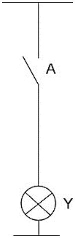 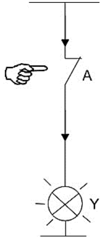

*Mynd 1 og 2: Opin snerta A og ljós Y. Til vinstri er ekki þrýst á A, til hægri er þrýst á A og ljósið logar.*

Þetta er mynd af snertu eða rofa (merktum A) og ljósi (merktu Y). Þegar þrýst er á rofa A lokast hann og fer að leiða straum. Þá kviknar ljós á peru Y.

Við getum táknað þessa virkni með $Y = A$, þ.e. þegar þrýst er á A kviknar á Y.

## 2. Hliðtengdar snertur

En ef við bætum öðrum rofa, B, við hliðina á A? Það kallast að hliðtengja B við A.

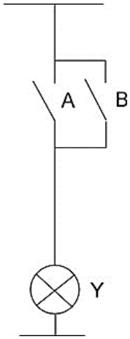

*Mynd 3: Hliðtengdar snertur A og B.*

Skiptir máli hvort við þrýstum á A eða B til að fá ljós á Y? Nei, það skiptir ekki máli, báðir gera það sama og straumnum er sama hvort hann fer í gegnum A eða B eða báða. Það kemur ekki meira ljós þó að við ýtum á báða; það er háð spennunni og viðnámi ljósaperunnar.

Við getum lýst þessu með $Y = A$ **EÐA** $B$; það kemur ljós ef þrýst er á A eða B.

Ef við myndum bæta þriðja rofanum, C, við hliðina á B og hliðtengja hann væri því lýst með $Y = A$ **EÐA** $B$ **EÐA** $C$. Það væri nóg að þrýsta á einhvern einn af þessum þremur rofum, þá kæmi ljós á Y. Svona virkar hliðtenging.

## 3. Raðtengdar snertur

Prófum nú að breyta tengingunni.

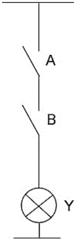 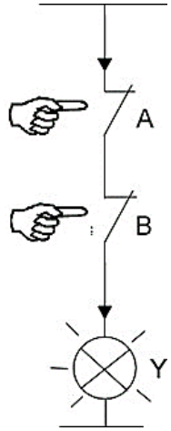

*Mynd 4 og 5: Raðtengdar snertur A og B. Til hægri er þrýst á báðar og ljósið logar.*

Til þess að ljósið Y fái straum er ljóst að það verður að þrýsta á bæði A og B. Við getum táknað það með $Y = A$ **OG** $B$, þ.e. það þarf að þrýsta á báða samtímis til að fá ljós á Y. Þetta er kallað að raðtengja A og B því þeir koma í lóðréttri röð.

Hvað ef við bætum við þriðju snertunni, C, neðan við B? Þá er ljóst að það þarf að ýta á allar þrjár, A, B og C, til að fá ljós.

Þetta getum við táknað með $Y = A$ **OG** $B$ **OG** $C$, þ.e. allar þrjár snerturnar verða að vera lokaðar. Svona virkar raðtenging.

## 4. Lokaðar snertur

Snertur eru af tveimur gerðum. Önnur gerðin er kölluð opin snerta (**NO** = *Normally Open*). Hún leiðir ekki straum nema þrýst sé á hana.

Hin gerðin kallast lokuð snerta (**NC** = *Normally Closed*). Hún leiðir straum ef ekki er þrýst á hana. Sé þrýst á hana hættir hún að leiða straum.

| 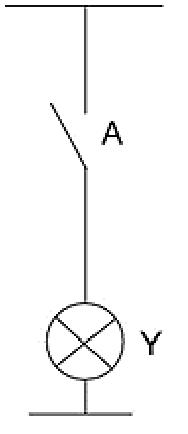 | 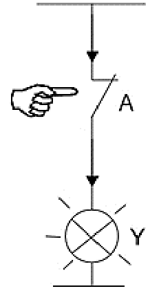 | 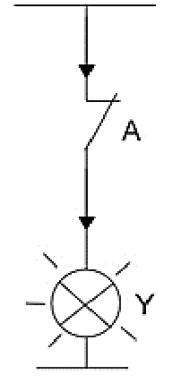 | 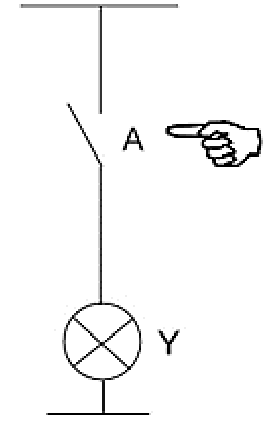 |
|:-:|:-:|:-:|:-:|
| Mynd 6: Opin snerta A í hlutlausri stöðu | Mynd 7: Opin snerta A í virkri stöðu | Mynd 8: Lokuð snerta A í hlutlausri stöðu | Mynd 9: Lokuð snerta A í virkri stöðu |

Opin snerta A kveikir ljós Y þegar þrýst er á hana.

Lokuð snerta A slekkur ljós Y þegar þrýst er á hana. Lokuð snerta leiðir straum þegar **EKKI** er þrýst á hana. Við getum lýst þessu með $Y =$ **EKKI** $A$, þ.e. það má ekki þrýsta á A ef ljósið á að vera kveikt.

## 5. Sambland hliðtengingar, raðtengingar og opinna og lokaðra snerta

Oftast eru rásir sambland af hliðtengingu og raðtengingu og með bæði opnar og lokaðar snertur. Tökum dæmi.

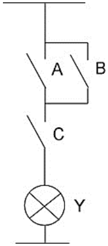

*Mynd 10: A og B hliðtengdar og raðtengdar við C.*

Til að kveikja á ljósi Y þarf að þrýsta á (A **EÐA** B) **OG** C. Við getum táknað það með $Y = (A$ **EÐA** $B)$ **OG** $C$.

Tökum annað dæmi.

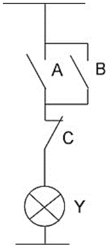

*Mynd 11: A og B hliðtengdar og raðtengdar við lokaða snertu C.*

Til að kveikja á ljósi Y verður að þrýsta á A eða B og ekki á C. Þetta má tákna með $Y = (A$ **EÐA** $B)$ **OG EKKI** $C$.

Sjáum að hliðtenging er **EÐA**, raðtenging **OG** og lokuð snerta **EKKI**.

Við munum kynnast nýjum rithætti á næstu blaðsíðum þar sem **EÐA** er skilgreint sem samlagning, **OG** sem margföldun og **EKKI** með striki yfir bókstaf.

## 6. Grunnhliðin OR, AND og NOT

**Hlið** eru rásir sem herma eftir ákveðnum tengingum, svo sem lokaðri snertu, hliðtengingu opinna og lokaðra snerta, raðtengingu opinna og lokaðra snerta og blönduðum tengingum opinna og lokaðra snerta.

Hlið eru táknuð með kassa. Vinstra megin á kassann koma inngangar hliðsins. Þeir eru minnst einn en oftast fleiri. Inngangar þjóna sama tilgangi í rökrásum og snertur og skynjarar í segulliðastýringum. Öll grunnhliðin hafa síðan einn útgang sem við táknum með bókstafnum Y í þessari bók. Útgangurinn kemur hægra megin út úr kassanum. Á hverjum kassa er síðan tákn sem segir til um hvað hliðið gerir (hvernig það virkar).

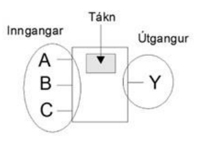

*Mynd 12: Dæmi um hlið með þrjá innganga, A, B og C, og útganginn Y.*

Virkni hvers hliðs er lýst með sannleikstöflu hliðsins sem segir hvernig útgangurinn hegðar sér í samræmi við stöðu innganganna.

### 6.1 Hvernig búum við til sannleikstöflur?

> Hvert hlið hefur sína **sannleikstöflu**.
>
> Í sannleikstöflum eru settar upp allar mögulegar stöður sem upp geta komið á inngöngum hliðanna og sýnt hvernig útgangurinn breytist í samræmi við stöður innganganna.
>
> Hlið sem hefur tvo innganga getur haft fjórar mismunandi stöður og hlið sem hefur þrjá innganga getur haft átta mismunandi stöður.
>
> Fjöldi lína í sannleikstöflu er $2^{\text{fjöldi innganga}}$.

Notum OR-hlið til skýringar. Við fáum síðar nánari skýringu á því hvað OR-hlið gerir. Einn inngangur getur bara haft tvær stöður, 0 eða 1 (*off* eða *on*). Ef við bætum við inngöngum fjölgar mögulegum stöðum innganganna sem margfeldi af tveimur. Dálkurinn lengst til hægri (útgangurinn) sýnir hvaða gildi útgangurinn tekur miðað við ákveðnar stöður á inngöngunum. Af því að þetta er OR-hlið skoðar það hvort inngangur A **EÐA** B sé virkur (1). Þessi kafli fjallar samt meira um það hvernig við gerum sannleikstöflu (stöðutöflu) innganganna.

**Tveir inngangar, A og B: fjórar stöður, $2^{2} = 4$, og því hefur taflan fjórar línur.**

| Inngangur A (gildi $2 = 2^{1}$) | Inngangur B (gildi $1 = 2^{0}$) | Útgangur $Y = A + B$ |
|:-:|:-:|:-:|
| 0 | 0 | 0 |
| 0 | 1 | 1 |
| 1 | 0 | 1 |
| 1 | 1 | 1 |

Sá inngangur sem er næst útganginum **Y** er gildisminnsti inngangurinn (LSB). Í þessu tilfelli er það inngangur **B**. Hann breytist hraðast og myndar mynstrið 0-1-0-1 niður á við. Sá sem er næst honum til vinstri, í þessu tilfelli inngangur **A**, er gildismeiri og skiptir því bara um stöðu í annað hvert skipti og myndar því mynstrið 0-0-1-1 niður á við. Almenna reglan er sú að inngangurinn næst útganginum **Y** (LSB) skiptir um stöðu í hverri línu, sá næsti til vinstri skiptir helmingi hægar, sá næsti vinstra megin við hann skiptir fjórum sinnum hægar o.s.frv.

**Þrír inngangar, A, B og C: átta stöður, $2^{3} = 8$, og því átta línur.**

| Inngangur A (gildi $4 = 2^{2}$) | Inngangur B (gildi $2 = 2^{1}$) | Inngangur C (gildi $1 = 2^{0}$) | Útgangur $Y = A + B + C$ |
|:-:|:-:|:-:|:-:|
| 0 | 0 | 0 | 0 |
| 0 | 0 | 1 | 1 |
| 0 | 1 | 0 | 1 |
| 0 | 1 | 1 | 1 |
| 1 | 0 | 0 | 1 |
| 1 | 0 | 1 | 1 |
| 1 | 1 | 0 | 1 |
| 1 | 1 | 1 | 1 |

Hér er inngangur **C** gildisminnstur (LSB). Hann skiptir því um stöðu í hverri línu og býr til mynstrið 0-1-0-1-0-1-0-1 niður á við.

Inngangur **B** er næstgildisminnstur. Hann endurtekur mynstrið 0-0-1-1-0-0-1-1 niður á við.

Inngangur **A** er gildismestur (MSB) og skiptir um stöðu fjórum sinnum hægar en inngangur **C** og myndar mynstrið 0-0-0-0-1-1-1-1 niður á við.

**Fjórir inngangar, A, B, C og D: sextán stöður, $2^{4} = 16$, og því sextán línur.**

| A (gildi $8 = 2^{3}$) | B (gildi $4 = 2^{2}$) | C (gildi $2 = 2^{1}$) | D (gildi $1 = 2^{0}$) | $Y = A + B + C + D$ |
|:-:|:-:|:-:|:-:|:-:|
| 0 | 0 | 0 | 0 | 0 |
| 0 | 0 | 0 | 1 | 1 |
| 0 | 0 | 1 | 0 | 1 |
| 0 | 0 | 1 | 1 | 1 |
| 0 | 1 | 0 | 0 | 1 |
| 0 | 1 | 0 | 1 | 1 |
| 0 | 1 | 1 | 0 | 1 |
| 0 | 1 | 1 | 1 | 1 |
| 1 | 0 | 0 | 0 | 1 |
| 1 | 0 | 0 | 1 | 1 |
| 1 | 0 | 1 | 0 | 1 |
| 1 | 0 | 1 | 1 | 1 |
| 1 | 1 | 0 | 0 | 1 |
| 1 | 1 | 0 | 1 | 1 |
| 1 | 1 | 1 | 0 | 1 |
| 1 | 1 | 1 | 1 | 1 |

Hér er inngangur **D** gildisminnstur (LSB) og myndar mynstrið 0-1-0-1-0-1-0-1-0-1-0-1-0-1-0-1.

- **C** myndar rununa 0-0-1-1 til skiptis,
- **B** myndar rununa 0-0-0-0-1-1-1-1 til skiptis og
- **A**, sem er gildismesti inngangurinn (MSB), myndar rununa 0-0-0-0-0-0-0-0-1-1-1-1-1-1-1-1, þ.e. $8\cdot 0$ og $8\cdot 1$ til skiptis.

**Samband gildis inngangsins og mynstursins af 0 og 1 sem inngangurinn myndar:**

| Gildi inngangs | Mynstur |
|:-:|:--|
| 1 | $1\cdot 0$ og $1\cdot 1$ til skiptis |
| 2 | $2\cdot 0$ og $2\cdot 1$ til skiptis |
| 4 | $4\cdot 0$ og $4\cdot 1$ til skiptis |
| 8 | $8\cdot 0$ og $8\cdot 1$ til skiptis |

### 6.2 OR-hlið (EÐA-hlið)

| DIN-staðall | ANSI-staðall | Útgangsjafna |
|:-:|:-:|:-:|
| 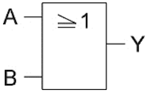 | 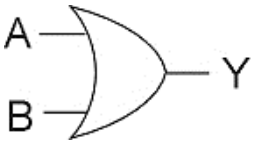 | $Y = A + B$ |
| Mynd 13: Tákn fyrir tveggja innganga OR-hlið í DIN-staðli. A og B eru inngangar (vinstri hlið) og Y er útgangur (hægri hlið). Táknið ≥1 hefur ákveðna þýðingu: ef einn eða fleiri inngangar eru 1 er útgangurinn 1. | Mynd 14: Tákn fyrir tveggja innganga OR-hlið í ANSI-staðli. Táknið hefur enga augljósa merkingu. | Útgangsjafna tveggja innganga OR-hliðs |

**OR-hlið** er rás sem hefur tvo eða fleiri innganga. Útgangur hennar (Y) verður hár (1) **ef** einn eða fleiri inngangar eru háir (sjá táknið á hliðinu). Á íslensku hefur þetta verið nefnt EÐA-hlið, þ.e. útgangurinn verður hár ef A EÐA B (eða báðir) eru háir.

Ef OR-hlið hefur 3 innganga breytist útgangsjafna þess í $Y = A + B + C$ og sannleikstaflan hefur $2^{3} = 8$ línur.

Tveggja innganga OR-hlið hefur eftirfarandi sannleikstöflu. A og B eru inngangarnir. Þeir eru tveir og sannleikstaflan hefur því $2^{2} = 4$ línur. Tveir inngangar geta því haft fjórar ólíkar stöður.

| A | B | $Y = A + B$ |
|:-:|:-:|:-:|
| 0 | 0 | 0 |
| 0 | 1 | 1 |
| 1 | 0 | 1 |
| 1 | 1 | 1 |

*Sannleikstafla fyrir tveggja innganga OR-hlið.*

Það kann að þykja einkennilegt út frá jöfnunni $Y = A + B$ að í neðstu línunni fáum við $1 + 1 = 1$ en hafa ber í huga að við erum ekki að vinna með venjulega algebru hér heldur svokallaða Boole-algebru (*Boolean algebra*) og 1 táknar hér ákveðið spennugildi (eða rökgildi) en ekki töluna 1.

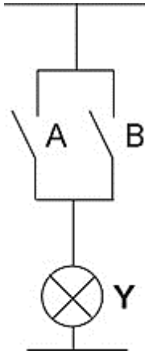

*Mynd 15: Rofarás sem lýsir OR-virkni.*

> OR-virkni má lýsa með rofarásinni á mynd 15. Táknum inngangana með rofunum A og B. Lokaður rofi leiðir straum og hefur þá gildið 1 en opinn rofi gildið 0. Ef A **EÐA** B **EÐA** báðir eru lokaðir (1) lýsir peran (Y). **OR**-virkni jafngildir því hliðtengingu opinna snerta í rofarás.

Líka má lýsa virkni OR-hliðs með svokallaðri díóðulógík, þ.e. hvernig búa má til OR-virkni með díóðurás.

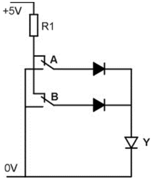

*Mynd 16: OR-virkni búin til með díóðurás (díóðulógík).*

### 6.3 AND-hlið (OG-hlið)

| DIN-staðall | ANSI-staðall | Útgangsjafna |
|:-:|:-:|:-:|
| 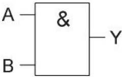 | 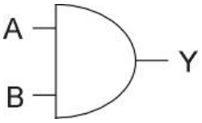 | $Y = AB$ |
| Mynd 17: Tákn fyrir tveggja innganga AND-hlið í DIN-staðli. Táknið **&** hefur ákveðna þýðingu: ef inngangarnir A **OG** B eru báðir 1 er útgangurinn 1. | Mynd 18: Tákn fyrir tveggja innganga AND-hlið í ANSI-staðli. Táknið hefur enga augljósa merkingu. | Útgangsjafna AND-hliðs |

AND-hlið er rás sem hefur tvo eða fleiri innganga. Útgangur hennar (Y) verður hár ef allir inngangar hennar eru háir, þ.e. A **OG** B **OG** C **OG** … Þess vegna er AND-hlið kallað **OG**-hlið á íslensku.

Útgangsjafna tveggja innganga AND-hliðs er $Y = AB$.

$AB$ þýðir A sinnum B, en eins og hefð er fyrir í stærðfræði er margföldunartákninu oftast sleppt.

Tveggja innganga AND-hlið hefur eftirfarandi sannleikstöflu.

| A | B | $Y = AB$ |
|:-:|:-:|:-:|
| 0 | 0 | 0 |
| 0 | 1 | 0 |
| 1 | 0 | 0 |
| 1 | 1 | 1 |

Sjáum að útgangurinn Y verður ekki 1 fyrr en bæði A **OG** B verða 1.

Þriggja innganga AND-hlið hefur útgangsjöfnuna $Y = ABC$.

Fjögurra innganga AND-hlið hefur útgangsjöfnuna $Y = ABCD$ o.s.frv.

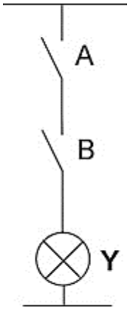

*Mynd 19: Rofarás sem lýsir AND-virkni.*

> AND-virkni má lýsa með rofarásinni á mynd 19. Táknum inngangana með rofunum A og B. Lokaður rofi leiðir straum og hefur þá gildið 1 en opinn rofi gildið 0. Ef A **OG** B eru báðir lokaðir (1) lýsir peran (Y). AND-virkni jafngildir því raðtengingu opinna snerta í rofarás.

### 6.4 NOT-hlið (EKKI-hlið)

| DIN-staðall | ANSI-staðall | Útgangsjafna |
|:-:|:-:|:-:|
| 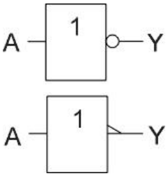 | 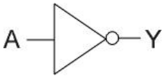 | $Y = \overline{A}$ |
| Mynd 20: Tákn fyrir NOT-hlið í DIN-staðli. Táknið **1** hefur ákveðna þýðingu. NOT-hlið hefur aðeins einn inngang. | Mynd 21: Tákn fyrir NOT-hlið í ANSI-staðli. Táknið hefur enga augljósa merkingu. | Strik fyrir ofan bókstaf táknar neitun eða **EKKI**. |

NOT-hlið hefur einfalda virkni. Það breytir 0 í 1 og 1 í 0, þ.e. það snýr öllu við sem kemur inn. Hringur eða þríhyrningur á útgangi þýðir viðsnúningur (*inverting*).

NOT-hlið hefur eftirfarandi sannleikstöflu.

| A | $Y = \overline{A}$ |
|:-:|:-:|
| 0 | 1 |
| 1 | 0 |

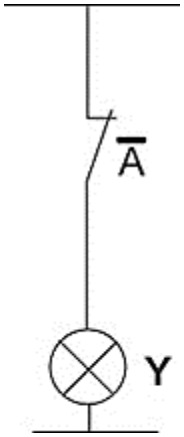

*Mynd 22: Rofarás sem lýsir NOT-virkni.*

> NOT-virkni má lýsa með rofarásinni á mynd 22. Táknum innganginn með rofanum A. Lokaður rofi leiðir straum og hefur þá gildið 1 en opinn rofi gildið 0. Ef $\overline{A}$ er lokaður ($\overline{0} = 1$) lýsir peran (Y). NOT-virkni jafngildir því lokaðri snertu í rofarás. Ef **EKKI** er ýtt á rofa A er ljós á peru Y.

## 7. Samsettu hliðin NOR og NAND

### 7.1 NOR-hlið (EKKI-EÐA-hlið)

| DIN-staðall | ANSI-staðall | Útgangsjafna |
|:-:|:-:|:-:|
| 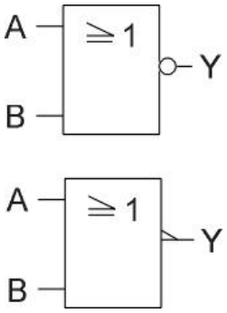 | 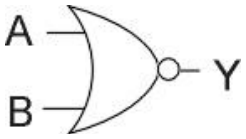 | $Y = \overline{A + B}$ |
| Mynd 23: Tákn fyrir tveggja innganga NOR-hlið í DIN-staðli. Táknið ≥1 hefur ákveðna þýðingu: ef einn eða fleiri inngangar eru 1 er útgangurinn 0 (akkúrat öfugt við OR). | Mynd 24: Tákn fyrir tveggja innganga NOR-hlið í ANSI-staðli. Táknið hefur enga augljósa merkingu. | Útgangsjafna NOR-hliðs |

NOR-hlið er ekkert annað en OR-hlið með útganginn tengdan í gegnum NOT-hlið.

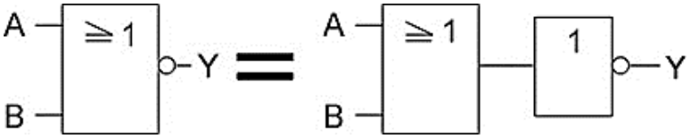

*Mynd 25: NOR-hlið jafngildir OR-hliði með NOT-hliði á útgangi.*

Útgangsjafnan er því útgangsjafna OR-hliðs, viðsnúin. Sannleikstaflan verður því sannleikstafla OR-hliðs, viðsnúin.

| A | B | OR: $Y = A + B$ | NOR: $Y = \overline{A + B}$ |
|:-:|:-:|:-:|:-:|
| 0 | 0 | 0 | 1 |
| 0 | 1 | 1 | 0 |
| 1 | 0 | 1 | 0 |
| 1 | 1 | 1 | 0 |

*Sannleikstafla OR-hliðs og NOR-hliðs.*

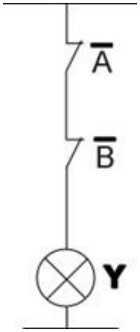

*Mynd 26: Rofarás sem lýsir NOR-virkni.*

> NOR-virkni má lýsa með rofarásinni á mynd 26. Táknum inngangana með rofunum A og B. Lokaður rofi leiðir straum og hefur þá gildið 1 en opinn rofi gildið 0. Ef $\overline{A}$ og $\overline{B}$ eru lokaðir ($\overline{0} = 1$) lýsir peran (Y), annars er hún slökkt. Um leið og við breytum stöðu A- eða B-rofans slökknar ljósið. NOR-virkni jafngildir því raðtengingu lokaðra snerta í rofarás. Þetta er afleiðing reglu De Morgans sem verður kynnt síðar: $\overline{A + B} = \overline{A}\cdot\overline{B}$.

### 7.2 NAND-hlið (EKKI-OG-hlið)

| DIN-staðall | ANSI-staðall | Útgangsjafna |
|:-:|:-:|:-:|
| 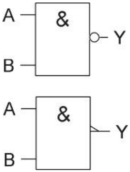 | 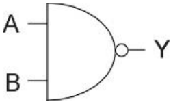 | $Y = \overline{AB}$ |
| Mynd 27: Tákn fyrir tveggja innganga NAND-hlið í DIN-staðli. Táknið **&** hefur ákveðna þýðingu: ef einn eða fleiri inngangar eru 0 er útgangurinn 1 (öfugt við AND). | Mynd 28: Tákn fyrir tveggja innganga NAND-hlið í ANSI-staðli. Táknið hefur enga augljósa merkingu. | Útgangsjafna NAND-hliðs |

NAND-hlið er ekkert annað en AND-hlið með útganginn tengdan í gegnum NOT-hlið.

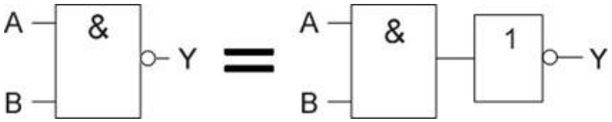

*Mynd 29: NAND-hlið jafngildir AND-hliði með NOT-hliði á útgangi.*

Útgangsjafnan er því útgangsjafna AND-hliðs, viðsnúin. Sannleikstaflan verður því sannleikstafla AND-hliðs, viðsnúin.

| A | B | AND: $Y = AB$ | NAND: $Y = \overline{AB}$ |
|:-:|:-:|:-:|:-:|
| 0 | 0 | 0 | 1 |
| 0 | 1 | 0 | 1 |
| 1 | 0 | 0 | 1 |
| 1 | 1 | 1 | 0 |

*Sannleikstafla AND-hliðs og NAND-hliðs.*

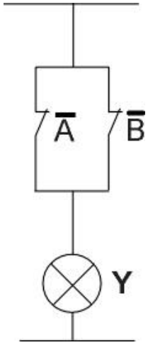

*Mynd 30: Rofarás sem lýsir NAND-virkni.*

> NAND-virkni má lýsa með rofarásinni á mynd 30. Táknum inngangana með rofunum A og B. Lokaður rofi leiðir straum og hefur þá gildið 1 en opinn rofi gildið 0. Ef $\overline{A}$ **EÐA** $\overline{B}$ er lokaður ($\overline{0} = 1$) lýsir peran (Y), annars er hún slökkt. Um leið og við breytum stöðu bæði A- og B-rofans slökknar ljósið. NAND-virkni jafngildir því hliðtengingu lokaðra snerta í rofarás. Þetta er afleiðing reglu De Morgans sem verður kynnt síðar: $\overline{AB} = \overline{A} + \overline{B}$.

## 8. XOR og XNOR

### 8.1 XOR-hlið

| DIN-staðall | ANSI-staðall | Útgangsjafna |
|:-:|:-:|:-:|
| 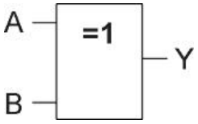 | 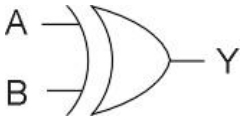 | $Y = A \oplus B = \overline{A}B + A\overline{B}$ |
| Mynd 31: Tákn fyrir XOR-hlið í DIN-staðli. Táknið **=1** hefur ákveðna þýðingu: ef nákvæmlega einn inngangur er 1 er útgangurinn 1. Þetta er því hið eiginlega EÐA-hlið (*Exclusive OR* = XOR). | Mynd 32: Tákn fyrir XOR-hlið í ANSI-staðli. Táknið hefur enga augljósa merkingu. | Útgangsjafna XOR-hliðs |

Sannleikstafla XOR-hliðs:

| A | B | $Y = A \oplus B = \overline{A}B + A\overline{B}$ |
|:-:|:-:|:-:|
| 0 | 0 | 0 |
| 0 | 1 | 1 |
| 1 | 0 | 1 |
| 1 | 1 | 0 |

Sjáum að þegar inngangar XOR-hliðs eru ekki eins er útgangurinn $Y = 1$.

Þessu má lýsa með eftirfarandi rofarás.

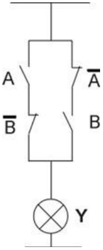

*Mynd 33: Rofarás sem lýsir XOR-virkni.*

### 8.2 XNOR-hlið

| DIN-staðall | ANSI-staðall | Útgangsjafna |
|:-:|:-:|:-:|
| 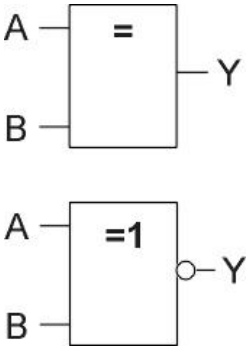 | 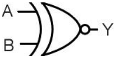 | $Y = \overline{A \oplus B} = \overline{A}\,\overline{B} + AB$ |
| Mynd 34: Tákn fyrir XNOR-hlið í DIN-staðli. Táknið **=** hefur ákveðna þýðingu: ef inngangarnir eru eins er útgangurinn 1. | Mynd 35: Tákn fyrir XNOR-hlið í ANSI-staðli. Táknið hefur enga augljósa merkingu. | Útgangsjafna XNOR-hliðs |

Sannleikstafla XNOR-hliðs:

| A | B | $Y = \overline{A \oplus B} = \overline{A}\,\overline{B} + AB$ |
|:-:|:-:|:-:|
| 0 | 0 | 1 |
| 0 | 1 | 0 |
| 1 | 0 | 0 |
| 1 | 1 | 1 |

Sjáum að þegar inngangar XNOR-hliðs eru eins er útgangurinn $Y = 1$.

Virkni XNOR-hliðs má skýra með eftirfarandi rofarás.

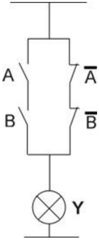

*Mynd 36: Rofarás sem lýsir XNOR-virkni.*

## 9. Neitun á inngangi og útgangi

### 9.1 Neitun á inngangi

**(Inngöngum er snúið við áður en hliðið framkvæmir aðgerð sína.)**

Hvernig túlkum við neitun á inngangi?

| Rás | Skýring |
|:-:|:--|
| 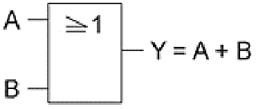 | Mynd 37: Hér er engin neitun, hvorki á inngangi né útgangi. |
| 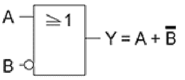 | Mynd 38: Hér er neitun á inngangi B sem þýðir að honum er snúið við áður en OR-hliðið leggur saman. |
| 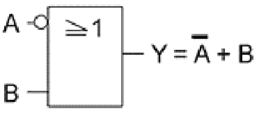 | Mynd 39: Hér er neitun á inngangi A sem þýðir að honum er snúið við áður en OR-hliðið leggur saman. |
| 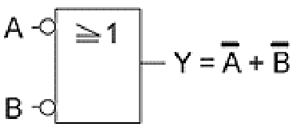 | Mynd 40: Hér er neitun á inngöngum A og B sem þýðir að þeim er báðum snúið við áður en OR-hliðið leggur saman. |

### 9.2 Neitun á útgangi

**(Útganginum er snúið við eftir að hliðið hefur framkvæmt aðgerð sína.)**

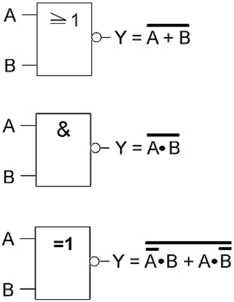

*Mynd 41: Neitun á útgangi.*

- Efst: Hér leggjum við saman A og B (**OR**) og snúum síðan útkomunni við: **NOR**.
- Í miðju: Hér margföldum við saman A og B (**AND**) og snúum síðan útkomunni við: **NAND**.
- Neðst: Hér er **XOR**-aðgerðin framkvæmd fyrst og síðan er útkomunni snúið við: **XNOR**.

### 9.3 Skiptir máli hvort neitunin er á inngangi eða útgangi?

Til þess að finna svarið við því þarf að skrifa niður sannleikstöflur beggja möguleika og bera þær saman. Tökum dæmi.

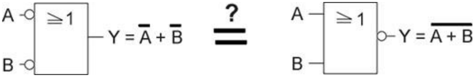

*Mynd 42: Er $\overline{A} + \overline{B}$ það sama og $\overline{A + B}$?*

Er þetta það sama? Skiptir máli hvort neitunin kemur á innganga OR-hliðs eða við notum bara NOR-hlið?

| A | B | $Y = \overline{A} + \overline{B}$ | $Y = \overline{A + B}$ |
|:-:|:-:|:-:|:-:|
| 0 | 0 | 1 | 1 |
| 0 | 1 | 1 | 0 |
| 1 | 0 | 1 | 0 |
| 1 | 1 | 0 | 0 |

Sjáum að rásirnar hafa ekki sömu sannleikstöflu og eru því ekki eins. **Það skiptir því máli hvort neitunin er á inngangi eða útgangi.**

## 10. Samtenging rökrásahliða, útgangsjöfnur

Skoðum rásina á myndinni hér að neðan. Hvernig getum við fundið útganginn Y á svona samtengdri rás?

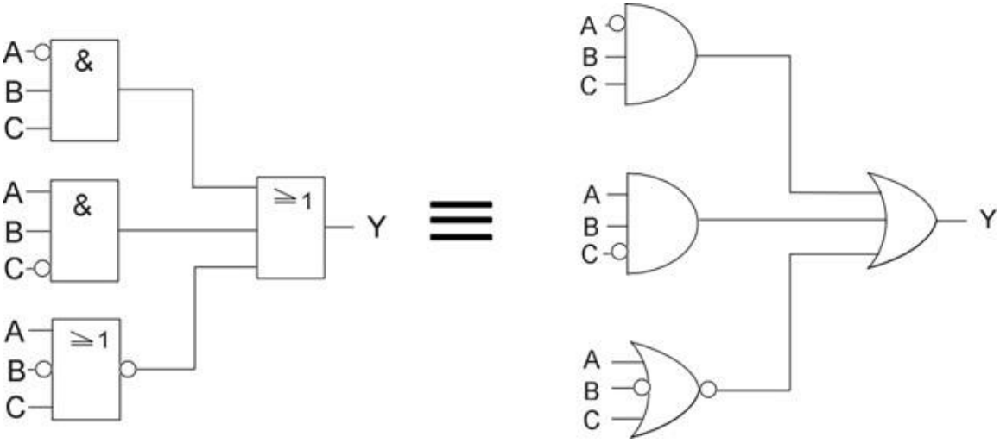

*Mynd 43: Rásin í DIN-staðli (til vinstri) og sama rás í ANSI-staðli (til hægri).*

Við byrjum á því að skoða útgangsjöfnur allra hliðanna fyrir framan síðasta hliðið (OR-hliðið). OR-hliðið leggur síðan saman alla þessa útganga og sú summa myndar útganginn Y.

Skoðum fyrst reglu sem kennd er við De Morgan.

> **Regla De Morgans segir okkur að við megum klippa í sundur stórar neitanir en við verðum þá að breyta margföldun í samlagningu eða samlagningu í margföldun.**

**Regla De Morgans 1:** $\overline{A + B} = \overline{A}\cdot\overline{B}$. Þegar við klippum í sundur stóra neitun yfir samlagningu breytist plús í margföldun.

**Regla De Morgans 2:** $\overline{AB} = \overline{A} + \overline{B}$. Þegar við klippum í sundur stóra neitun yfir margföldun breytist margföldun í plús.

Næst skulum við átta okkur á því að tvöföld neitun jafngildir engri neitun og þreföld neitun jafngildir einni neitun:

$$
\overline{\overline{A}} = A \qquad \overline{\overline{\overline{A}}} = \overline{A}
$$

Þetta þýðir almennt að:

- Slétttölufjöldi (jafntölufjöldi) neitana jafngildir engri neitun.
- Oddatölufjöldi neitana jafngildir einni neitun.
- Það má klippa stórar neitanir á fleiri en einum stað.

Tökum dæmi:

$$
\overline{\overline{A} + B + \overline{C}} = \overline{\overline{A}}\cdot\overline{B}\cdot\overline{\overline{C}} = A\cdot\overline{B}\cdot C = A\overline{B}C
$$

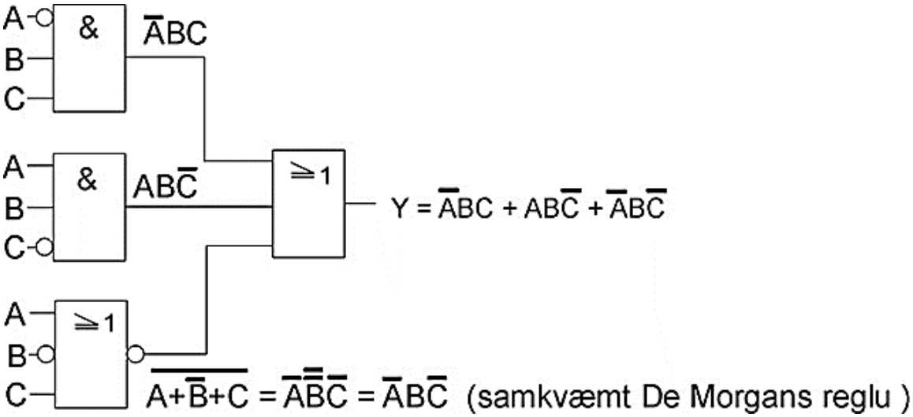

*Mynd 44: Útgangsjafna samtengdu rásarinnar.*

Útganginn á neðsta hliðinu (NOR) má einfalda með reglu De Morgans eins og gert er á myndinni. Útgangsjafnan verður þá

$$
Y = \overline{A}BC + AB\overline{C} + \overline{A}B\overline{C}
$$

því síðasta hliðið leggur saman innganga sína.

Næst búum við til sannleikstöflu með 8 línum. Fjöldi innganga er 3 og $2^{3} = 8$. Við gerum sérstakan dálk fyrir hvern inngang sem kemur inn á síðasta hliðið (**OR**). Fyrir liðinn $\overline{A}BC$ leitum við að línunni 011 í sannleikstöflunni, fyrir $AB\overline{C}$ að línunni 110 og fyrir $\overline{A}B\overline{C}$ að línunni 010. Bara á þessum stöðum kemur 1 í útkomu vegna AND-virkninnar, annars 0. Lokaútkoman er síðan summa (vegna OR-hliðsins) hverrar línu í sannleikstöflunni.

| A | B | C | $\overline{A}BC$ | $AB\overline{C}$ | $\overline{A}B\overline{C}$ | $Y$ |
|:-:|:-:|:-:|:-:|:-:|:-:|:-:|
| 0 | 0 | 0 | 0 | 0 | 0 | 0 |
| 0 | 0 | 1 | 0 | 0 | 0 | 0 |
| **0** | **1** | **0** | 0 | 0 | **1** | **1** |
| **0** | **1** | **1** | **1** | 0 | 0 | **1** |
| 1 | 0 | 0 | 0 | 0 | 0 | 0 |
| 1 | 0 | 1 | 0 | 0 | 0 | 0 |
| **1** | **1** | **0** | 0 | **1** | 0 | **1** |
| 1 | 1 | 1 | 0 | 0 | 0 | 0 |

**Annað dæmi:**

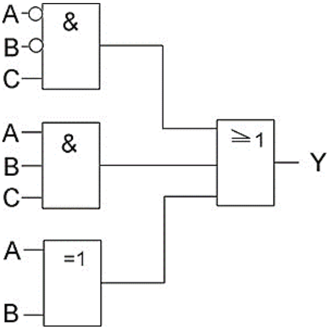

*Mynd 45: Annað dæmi um samtengda rás.*

Byrjum á því að skrifa útgangsjöfnur hliðanna þriggja á undan OR-hliðinu. OR-hliðið leggur síðan saman þær útkomur.

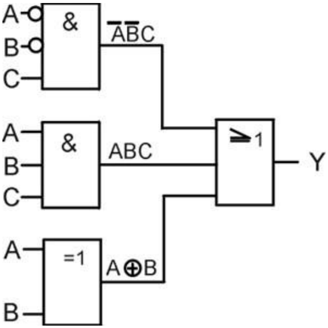

*Mynd 46: Útgangsjöfnur hliðanna.*

Fyrir $\overline{A}\,\overline{B}C$ leitum við að línunni 001 því það er eina línan sem gefur 1 fyrir þá jöfnu. Fyrir $ABC$ leitum við að línunni 111. Fyrir XOR-hliðið (neðst) munum við að það gefur bara 1 á útgang þegar inngangarnir eru ekki eins. Við þurfum því að skoða dálkana fyrir **A** og **B** og skoða hvenær **A** og **B** eru ekki eins.

Útkoman er:

$$
Y = \overline{A}\,\overline{B}C + ABC + A \oplus B
$$

Sannleikstaflan er því:

| A | B | C | $\overline{A}\,\overline{B}C$ | $ABC$ | $A \oplus B$ | $Y$ |
|:-:|:-:|:-:|:-:|:-:|:-:|:-:|
| 0 | 0 | 0 | 0 | 0 | 0 | 0 |
| **0** | **0** | **1** | **1** | 0 | 0 | **1** |
| **0** | **1** | 0 | 0 | 0 | **1** | **1** |
| **0** | **1** | 1 | 0 | 0 | **1** | **1** |
| **1** | **0** | 0 | 0 | 0 | **1** | **1** |
| **1** | **0** | 1 | 0 | 0 | **1** | **1** |
| 1 | 1 | 0 | 0 | 0 | 0 | 0 |
| **1** | **1** | **1** | 0 | **1** | 0 | **1** |

Við lærum síðar hvernig hægt er að einfalda svona rásir annaðhvort með **Boole-algebru** eða **Karnaugh-korti** (3. hefti).

## 11. NOR-lógík

Er hægt að búa til öll rökrásahlið bara með NOR-hliðum? Svarið er já, það er hægt. Skoðum möguleikana.

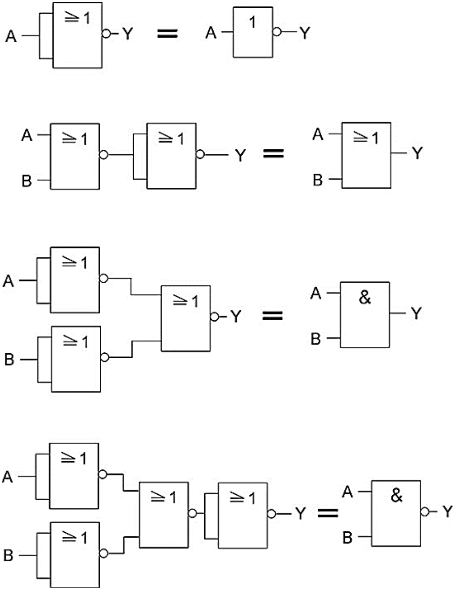

*Mynd 47: NOT, OR, AND og NAND búin til eingöngu úr NOR-hliðum.*

Þegar við tengjum saman tvo innganga í einn virkar það eins og einn inngangur. Þannig er hægt að búa til NOT-hlið úr NOR-hliði.

Er hægt að búa til öll hlið með NAND-hliðum? Er til NAND-lógík? (Sjá verkefni 6.)

## 12. Rásir teiknaðar eftir rökrásajöfnum

Hvernig teiknum við rás ef við fáum gefna rökrásajöfnu? Við byrjum á að skoða hvort liðir eða þættir jöfnunnar eru tengdir saman með samlagningu eða margföldun. Séu þeir settir saman með samlagningu endar rásin á OR-hliði. Sé rásin sett saman með margföldun endar hún á AND-hliði. Við vinnum sem sagt frá hægri til vinstri, eða frá útgangi til innganga.

**Dæmi 1**

$$
Y = \overline{A}BC + AB\overline{C} + A\overline{B}C
$$

Þessi jafna er sett saman með samlagningu og endar því á OR-hliði. Það sem kemur inn á OR-hliðið er útkoma úr þremur AND-hliðum sem mynda margfeldin. Við þurfum því OR-hlið með þremur inngöngum og þrjú AND-hlið með þremur inngöngum hvert. Að síðustu þurfum við þrjú NOT-hlið til að búa til neitanir á inngöngum (á myndinni eru þær sýndar sem hringir á inngöngum).

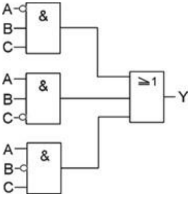

*Mynd 48: Rás teiknuð eftir jöfnunni í dæmi 1.*

**Dæmi 2**

$$
Y = (A + B + \overline{C})\cdot(A + \overline{B} + C)
$$

Sjáum að þetta er margfeldi tveggja summa. Rásin endar því á AND-hliði en summurnar eru búnar til með tveimur OR-hliðum. Að lokum þurfum við tvö NOT-hlið fyrir neitanirnar á C og B.

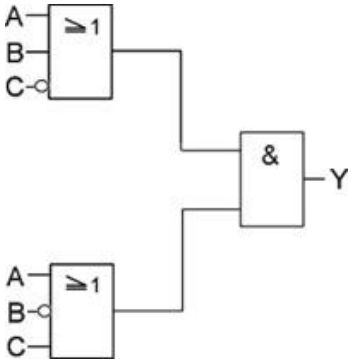

*Mynd 49: Rás teiknuð eftir jöfnunni í dæmi 2.*

## 13. Verkefni

**(Ekki nota bara svörin, það er sjálfsblekking.)**

**1.** Hvað heita rásirnar?

| I) | II) | III) | IV) |
|:-:|:-:|:-:|:-:|
| 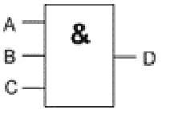 |  |  |  |
| Mynd 50 | Mynd 51 | Mynd 52 | Mynd 53 |

| V) | VI) | VII) |
|:-:|:-:|:-:|
|  |  |  |
| Mynd 54 | Mynd 55 | Mynd 56 |

Hver er útgangsjafna þeirra?

I) $D =$\
II) $F =$\
III) $I =$\
IV) $L =$\
V) $P =$\
VI) $T =$\
VII) $W =$

Fyllið út í sannleikstöflurnar.

| A | B | C | D | | E | F | | G | H | I | | J | K | L |
|:-:|:-:|:-:|:-:|:-:|:-:|:-:|:-:|:-:|:-:|:-:|:-:|:-:|:-:|:-:|
| 0 | 0 | 0 | | | 0 | | | 0 | 0 | | | 0 | 0 | |
| 0 | 0 | 1 | | | 1 | | | 0 | 1 | | | 0 | 1 | |
| 0 | 1 | 0 | | | | | | 1 | 0 | | | 1 | 0 | |
| 0 | 1 | 1 | | | | | | 1 | 1 | | | 1 | 1 | |
| 1 | 0 | 0 | | | | | | | | | | | | |
| 1 | 0 | 1 | | | | | | | | | | | | |
| 1 | 1 | 0 | | | | | | | | | | | | |
| 1 | 1 | 1 | | | | | | | | | | | | |

| M | N | O | P | | R | S | T | | U | V | W |
|:-:|:-:|:-:|:-:|:-:|:-:|:-:|:-:|:-:|:-:|:-:|:-:|
| 0 | 0 | 0 | | | 0 | 0 | | | 0 | 0 | |
| 0 | 0 | 1 | | | 0 | 1 | | | 0 | 1 | |
| 0 | 1 | 0 | | | 1 | 0 | | | 1 | 0 | |
| 0 | 1 | 1 | | | 1 | 1 | | | 1 | 1 | |
| 1 | 0 | 0 | | | | | | | | | |
| 1 | 0 | 1 | | | | | | | | | |
| 1 | 1 | 0 | | | | | | | | | |
| 1 | 1 | 1 | | | | | | | | | |

**2.** Finnið útgangsjöfnu rásarinnar og fyllið síðan út í sannleikstöfluna. Þið getið notað **reglu De Morgans** til að einfalda útkomu NOR-hliðsins.

*Mynd 57: Rásin í verkefni 2.*

| A | B | C | $Y =$ |
|:-:|:-:|:-:|:-:|
| 0 | 0 | 0 | |
| 0 | 0 | 1 | |
| 0 | 1 | 0 | |
| 0 | 1 | 1 | |
| 1 | 0 | 0 | |
| 1 | 0 | 1 | |
| 1 | 1 | 0 | |
| 1 | 1 | 1 | |

**3.** Hvernig breytist sannleikstaflan í verkefni 2 við þessa breytingu á rásinni?

*Mynd 58: Breytt rás (verkefni 3).*

**4.** Gera þessar rásir sama hlutinn? Skrifið útgangsjöfnur þeirra og notið síðan **reglu De Morgans** á NOR-hliðið.

*Mynd 59: Rásirnar í verkefni 4.*

**5.** Er sama hvort við setjum neitanir á innganga AND-hliðs eða notum bara NAND-hlið?

**6.** Sýnið fram á að hægt sé að búa til NOT, OR, NOR og AND með því að nota eingöngu NAND-hlið (NAND-lógík).

**7.** Teiknið rás eftir eftirfarandi jöfnu:

$$
Y = A\overline{B}C + \overline{A}BC
$$

**8.** Teiknið rás eftir eftirfarandi jöfnu:

$$
Y = \overline{A}\,\overline{B}C + AB\overline{C} + A \oplus B + \overline{B \oplus C}
$$

## 14. Svör

**1.** I) AND, II) NOT, III) XOR, IV) OR, V) NOR, VI) NAND, VII) XNOR.

Útgangsjöfnurnar eru:

$$
D = ABC \qquad F = \overline{E} \qquad I = G \oplus H \qquad L = J + K
$$

$$
P = \overline{M + N + O} \qquad T = \overline{RS} \qquad W = \overline{U \oplus V}
$$

| A | B | C | **D** | | E | **F** | | G | H | **I** | | J | K | **L** |
|:-:|:-:|:-:|:-:|:-:|:-:|:-:|:-:|:-:|:-:|:-:|:-:|:-:|:-:|:-:|
| 0 | 0 | 0 | **0** | | 0 | **1** | | 0 | 0 | **0** | | 0 | 0 | **0** |
| 0 | 0 | 1 | **0** | | 1 | **0** | | 0 | 1 | **1** | | 0 | 1 | **1** |
| 0 | 1 | 0 | **0** | | | | | 1 | 0 | **1** | | 1 | 0 | **1** |
| 0 | 1 | 1 | **0** | | | | | 1 | 1 | **0** | | 1 | 1 | **1** |
| 1 | 0 | 0 | **0** | | | | | | | | | | | |
| 1 | 0 | 1 | **0** | | | | | | | | | | | |
| 1 | 1 | 0 | **0** | | | | | | | | | | | |
| 1 | 1 | 1 | **1** | | | | | | | | | | | |

| M | N | O | **P** | | R | S | **T** | | U | V | **W** |
|:-:|:-:|:-:|:-:|:-:|:-:|:-:|:-:|:-:|:-:|:-:|:-:|
| 0 | 0 | 0 | **1** | | 0 | 0 | **1** | | 0 | 0 | **1** |
| 0 | 0 | 1 | **0** | | 0 | 1 | **1** | | 0 | 1 | **0** |
| 0 | 1 | 0 | **0** | | 1 | 0 | **1** | | 1 | 0 | **0** |
| 0 | 1 | 1 | **0** | | 1 | 1 | **0** | | 1 | 1 | **1** |
| 1 | 0 | 0 | **0** | | | | | | | | |
| 1 | 0 | 1 | **0** | | | | | | | | |
| 1 | 1 | 0 | **0** | | | | | | | | |
| 1 | 1 | 1 | **0** | | | | | | | | |

*Mynd 60: Útgangsjöfnur hliðanna í verkefni 2.*

**2.** $Y = \overline{A}BC + AB\overline{C} + A\overline{B}C$, því samkvæmt reglu De Morgans er $\overline{\overline{A} + B + \overline{C}} = A\overline{B}C$.

| A | B | C | $\overline{A}BC$ | $AB\overline{C}$ | $A\overline{B}C$ | $Y$ |
|:-:|:-:|:-:|:-:|:-:|:-:|:-:|
| 0 | 0 | 0 | 0 | 0 | 0 | **0** |
| 0 | 0 | 1 | 0 | 0 | 0 | **0** |
| 0 | 1 | 0 | 0 | 0 | 0 | **0** |
| 0 | 1 | 1 | **1** | 0 | 0 | **1** |
| 1 | 0 | 0 | 0 | 0 | 0 | **0** |
| 1 | 0 | 1 | 0 | 0 | **1** | **1** |
| 1 | 1 | 0 | 0 | **1** | 0 | **1** |
| 1 | 1 | 1 | 0 | 0 | 0 | **0** |

**3.** Öll gildi útgangsins Y víxlast, 0 verður 1 og 1 verður 0.

**4.** Vinstri rásin hefur útgangsjöfnuna $\overline{A}BC$ og hægri rásin $\overline{A + \overline{B} + \overline{C}}$. Ef við beitum reglu De Morgans á hægri rásina fæst

$$
\overline{A + \overline{B} + \overline{C}} = \overline{A}\cdot\overline{\overline{B}}\cdot\overline{\overline{C}} = \overline{A}BC
$$

sem er sama útkoma og hjá rásinni vinstra megin. Þessar rásir gera því það sama.

**5.** Tökum sem dæmi þriggja innganga AND-hlið. Ef við setjum neitun á alla innganga verður útgangurinn $Y = \overline{A}\,\overline{B}\,\overline{C}$. Ef við setjum bara neitun á útganginn verður útgangsjafnan $Y = \overline{ABC}$ sem er útgangsjafna NAND-hliðs. Er þetta sama virknin? Prófum að beita reglu De Morgans á seinni jöfnuna:

$$
\overline{ABC} = \overline{A} + \overline{B} + \overline{C}
$$

Þetta er því greinilega ekki sama virknin.

**6.**

*Mynd 61: NOT, AND, OR og NOR búin til eingöngu úr NAND-hliðum.*

**7.** $Y = A\overline{B}C + \overline{A}BC$

*Mynd 62: Lausn á verkefni 7.*

**8.** $Y = \overline{A}\,\overline{B}C + AB\overline{C} + A \oplus B + \overline{B \oplus C}$

*Mynd 63: Lausn á verkefni 8.*
