> Þetta hefti er án endurgjalds á rafbókinni [www.rafbok.is](https://www.rafbok.is). Allir rafiðnaðarmenn og rafiðnaðarnemar geta fengið aðgang að rafbókinni án endurgjalds.
>
> Heimilt er að afrita textann til fræðslu í skólum sem reknir eru fyrir opinbert fé án leyfis höfundar eða Rafmenntar, fræðsluseturs rafiðnaðarins. Hvers konar sala á textanum í heild eða að hluta til er óheimil nema að fengnu leyfi höfundar og Rafmenntar.
>
> Vinsamlegast sendið leiðréttingar og athugasemdir til höfundar eða til Báru Laxdal Halldórsdóttur á netfangið <bara@rafmennt.is>.
>
> Höfundur er Eiríkur Guðmundsson. Umbrot í rafbók: Bára Laxdal Halldórsdóttir.

## 1. Karnaugh-kort (K-kort)

Góð aðferð til þess að finna rökrásir út frá sannleikstöflu eða einfalda rökrásir er að nota svokallað Karnaugh-kort (K-kort). K-kortið er sett þannig upp að hver reitur í því samsvarar einni línu í sannleikstöflunni. Ef sannleikstaflan inniheldur 8 línur samanstendur K-kortið af 8 reitum.

Reitunum er raðað þannig að aðeins er leyfð ein breyting á inngöngum á milli lína eða dálka. Þetta er kallað Gray-kóði (*Gray code*).

**Dæmi 1:**

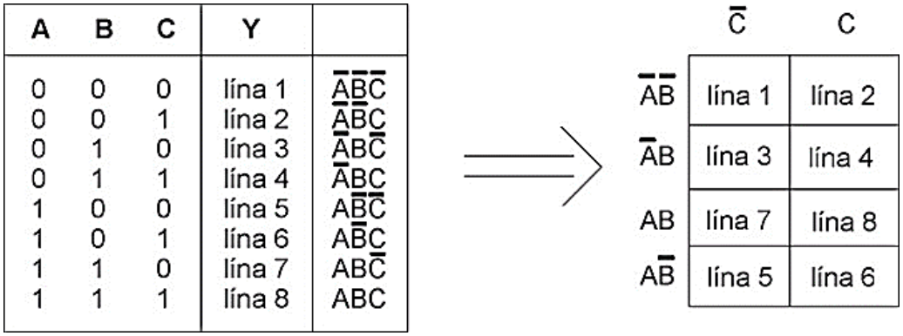

*Mynd 1: Hver lína sannleikstöflunnar á sér einn reit í K-kortinu.*

**Dæmi 2:** Skoðum eftirfarandi K-kort og hvernig það er notað.

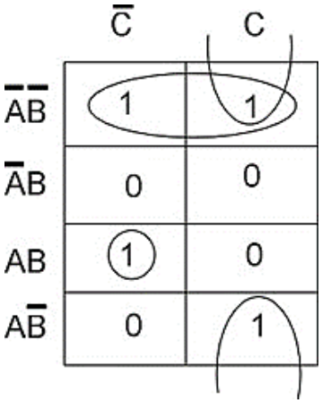

*Mynd 2: K-kort með þremur lykkjum.*

> **Reglur:**
>
> 1. Það má lykkja saman 1, 2, 4 eða 8 reiti sem eru samliggjandi lárétt eða lóðrétt og innihalda töluna **1** (mest 16 reiti ef kortið inniheldur 16 reiti).
> 2. Jaðrar kortsins teljast vera samliggjandi, þ.e. efsta og neðsta línan og vinstri og hægri brún.
> 3. Sá bókstafur sem breytist innan lykkjunnar (er bæði með neitun og án neitunar) dettur út því hann hefur ekki áhrif á útkomuna.
> 4. Útgangsjafnan verður summa útkomanna úr hverri lykkju.
> 5. Reynum að taka eins fáar og eins stórar lykkjur og við getum. Stærri lykkjur þýða að fleiri bókstafir detta út.
> 6. Það má samnýta reiti eins oft og þarf.

Lykkjan í efstu línu inniheldur $\overline{A}\,\overline{B}\,\overline{C}$ og $\overline{A}\,\overline{B}C$. Sjáum að **C** breytist innan lykkjunnar ($\overline{C}$ og $C$) og dettur því út. Eftir stendur $\overline{A}\,\overline{B}$.

Staka lykkjan í 3. línu parast ekki með neinum öðrum reit og einfaldast því ekkert. Útkoman úr henni er því $AB\overline{C}$.

Lóðrétta lykkjan úr efstu og neðstu línu lykkjar saman $\overline{A}\,\overline{B}C$ og $A\overline{B}C$. Sjáum að **A** breytist og dettur því út. Útkoman úr þessari lykkju er því $\overline{B}C$.

Útgangsjafna kortsins er því:

$$
Y = \overline{A}\,\overline{B} + AB\overline{C} + \overline{B}C
$$

Rásin er þá:

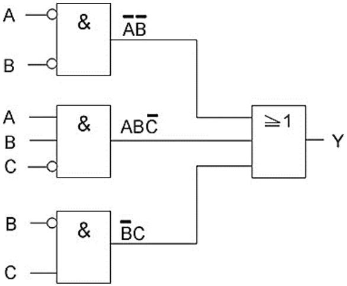

*Mynd 3: Rásin fyrir $Y = \overline{A}\,\overline{B} + AB\overline{C} + \overline{B}C$.*

**Dæmi 3:** Skoðum eftirfarandi sannleikstöflu, færum hana inn í K-kort og finnum einföldustu rás sem gefur þessa niðurstöðu. Skoðum bara línur þar sem útgangurinn er 1.

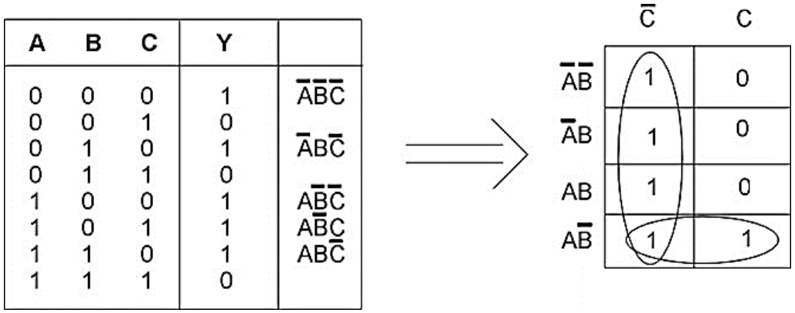

*Mynd 4: Sannleikstaflan færð inn í K-kort.*

Sjáum að fyrsti dálkurinn lykkjast allur saman. Eini inngangurinn sem breytist ekkert er $\overline{C}$ og niðurstaðan úr lykkjunni er því $\overline{C}$.

Neðsta línan lykkjast síðan saman og þar breytist **C** og dettur því út og gefur niðurstöðuna $A\overline{B}$.

Útgangsjafna kortsins er því:

$$
Y = \overline{C} + A\overline{B}
$$

Rásin er þá:

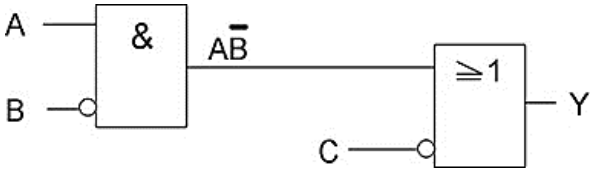

*Mynd 5: Rásin fyrir $Y = \overline{C} + A\overline{B}$.*

**Dæmi 4:** Tökum nú stærra dæmi, með 4 inngöngum. Færum inn línur með 1 í útgangi og fyllum síðan upp með 0.

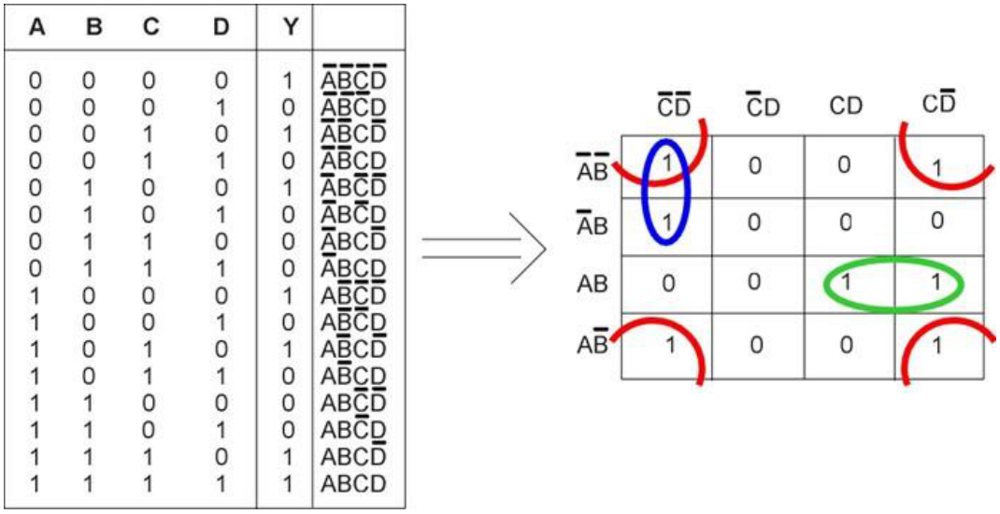

*Mynd 6: Sannleikstafla með fjórum inngöngum færð inn í K-kort með rauðri, blárri og grænni lykkju.*

Hér höfum við 4 innganga sem gefa $2^{4} = 16$ möguleika. Það eru því 16 reitir í K-kortinu. Munum að jaðrarnir teljast vera samliggjandi; dálkur 1 er því samliggjandi dálki 4 og lína 1 er samliggjandi línu 4.

Reitirnir í hornunum (merktir með rauðu) eru því samliggjandi og geta lykkjast saman. Sjáum að **A** breytist frá línu 1 til línu 4 og **C** breytist frá dálki 1 til dálks 4 í rauðu lykkjunni. Inngangarnir sem þá verða eftir eru $\overline{B}\,\overline{D}$.

Bláa lykkjan gefur $\overline{A}\,\overline{C}\,\overline{D}$ og græna lykkjan gefur $ABC$.

Útgangsjafnan verður því:

$$
Y = \overline{B}\,\overline{D} + \overline{A}\,\overline{C}\,\overline{D} + ABC
$$

K-kort byggjast á summu margfelda (SOP = *Sum Of Products*). Það þýðir að útgangshliðið er OR-hlið með jafnmörgum inngöngum og lykkjur K-kortsins eru margar.

Hægt er að teikna K-kortið á annan hátt. Þá setjum við inn stöður innganganna sem 0 eða 1 í stað þess að nota bókstafi og bókstafi með yfirstrikun. Þetta finnst mörgum þægilegra og það auðveldar yfirfærslu úr sannleikstöflunni yfir í K-kortið.

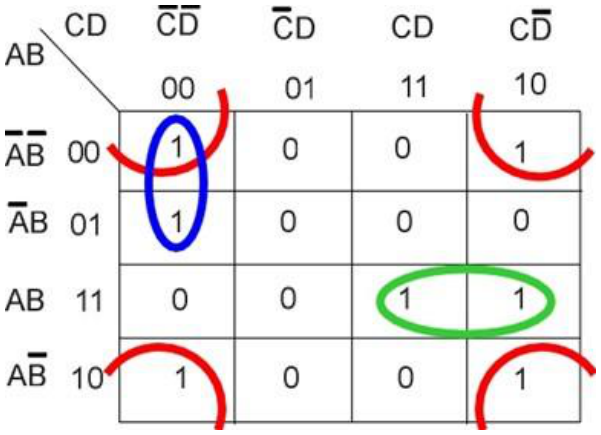

*Mynd 7: K-kortið úr dæmi 4 þar sem stöður innganganna eru skrifaðar bæði sem bókstafir og sem 0 og 1.*

Það má segja að það að nota 0 og 1 auðveldi yfirfærsluna úr sannleikstöflunni en bókstafirnir auðveldi að finna útgangsjöfnuna og eins að setja inn í kortið út frá gefinni jöfnu.

## 2. Boole-algebra

Önnur aðferð til þess að einfalda rásir er að beita svokallaðri **Boole-algebru** (*Boolean algebra*). Skoðum þær reiknireglur sem gilda í þessari algebru.

### 2.1 Reiknireglur Boole-algebru

Þær eru 20 talsins og eru paraðar saman tvær og tvær sem eru skyldar. Síðustu tvær eru nefndar reglur De Morgans. Sú fyrri (samlagning) sýnir sambandið á milli NOR-hliðs og AND-hliðs með viðsnúnum inngöngum. Sú seinni (margföldun) sýnir sambandið á milli NAND-hliðs og OR-hliðs með viðsnúnum inngöngum.

| Nr. | a) Samlagning | b) Margföldun |
|:-:|:-:|:-:|
| 1 | $A + A = A$ | $A\cdot A = A$ |
| 2 | $(A + B) + C = A + (B + C)$ | $(A\cdot B)\cdot C = A\cdot(B\cdot C)$ |
| 3 | $A + B = B + A$ | $A\cdot B = B\cdot A$ |
| 4 | $A + BC = (A + B)(A + C)$ | $A(B + C) = AB + AC$ |
| 5 | $A + 0 = A$ | $A\cdot 1 = A$ |
| 6 | $A + 1 = 1$ | $A\cdot 0 = 0$ |
| 7 | $A + \overline{A} = 1$ | $A\cdot\overline{A} = 0$ |
| 8 | $A + AB = A$ | $A(A + B) = A$ |
| 9 | $\overline{A} + AB = \overline{A} + B$ | $A + \overline{A}B = A + B$ |
| 10 (De Morgan) | $\overline{A + B} = \overline{A}\cdot\overline{B}$ | $\overline{A\cdot B} = \overline{A} + \overline{B}$ |

Þessar reglur er best að sanna með því að búa til sannleikstöflur fyrir báðar hliðar **=**-merkisins.

Tökum sem dæmi reglu 9a: $\overline{A} + AB = \overline{A} + B$. Búum til sannleikstöflu:

| A | B | $\overline{A} + AB$ | $\overline{A} + B$ |
|:-:|:-:|:-:|:-:|
| 0 | 0 | 1 | 1 |
| 0 | 1 | 1 | 1 |
| 1 | 0 | 0 | 0 |
| 1 | 1 | 1 | 1 |

Sannleikstaflan skilar tveimur eins útgöngum og regla 9a er því rétt.

**Dæmi 1:**

$$
\overline{A}B\overline{C} + \overline{A}BC
$$

Byrjum á að taka sameiginlegar stærðir út fyrir sviga eins og um venjulega algebru væri að ræða (sjá reglu 4b). Þá fáum við:

$$
\overline{A}B(\overline{C} + C)
$$

Samkvæmt reglu 7a er $\overline{C} + C = 1$ og við erum því að margfalda $\overline{A}B$ með **1** sem gefur $\overline{A}B$ samkvæmt reglu 5b. Því er:

$$
\overline{A}B\overline{C} + \overline{A}BC = \overline{A}B
$$

**Dæmi 2:**

$$
\overline{A}B\overline{C} + \overline{A}BC + \overline{A}\,\overline{B}C
$$

Samkvæmt reglu 1a megum við bæta við stærð sem fyrir er í dæminu eins oft og okkur hentar. Þetta samsvarar því að samnýta reit í K-korti. Bætum t.d. $\overline{A}BC$ við og fáum

$$
\overline{A}B\overline{C} + \overline{A}BC + \overline{A}\,\overline{B}C + \overline{A}BC
$$

Við höfum ekki eyðilagt neitt með þessu. Núna getum við tekið $\overline{A}B$ út fyrir sviga í fyrstu tveimur liðunum og $\overline{A}C$ út fyrir sviga í tveimur seinni liðunum. Þá fæst:

$$
\overline{A}B(\overline{C} + C) + \overline{A}C(\overline{B} + B) = \overline{A}B + \overline{A}C = \overline{A}(B + C)
$$

**Dæmi 3:**

$$
(A + B + \overline{C})(\overline{A} + B + \overline{C})
$$

Margföldum upp úr svigunum á hefðbundinn hátt (skýringar til hægri):

$$
\begin{aligned}
& A\overline{A} + AB + A\overline{C} + B\overline{A} + BB + B\overline{C} + \overline{C}\,\overline{A} + \overline{C}B + \overline{C}\,\overline{C} && \\
&= 0 + AB + A\overline{C} + B\overline{A} + B + B\overline{C} + \overline{C}\,\overline{A} + \overline{C}B + \overline{C} && [A\overline{A} = 0,\; BB = B,\; \overline{C}\,\overline{C} = \overline{C}] \\
&= B(A + \overline{A}) + \overline{C}(A + \overline{A}) + B\overline{C} + B + \overline{C} && [B\overline{C} + \overline{C}B = B\overline{C}] \\
&= B + \overline{C} + B\overline{C} + B + \overline{C} && [B(A + \overline{A}) = B,\; \overline{C}(A + \overline{A}) = \overline{C}] \\
&= B + \overline{C} + B\overline{C} && [B + B = B,\; \overline{C} + \overline{C} = \overline{C}] \\
&= B + \overline{C}(1 + B) = B + \overline{C} && [1 + B = 1]
\end{aligned}
$$

## 3. Rofarásum breytt í rökrásir

Allar rofarásir eiga sér samsvarandi rökrás. Það eru t.d. til stýrivélar sem vinna eingöngu með rökrásatákn og oft þarf að forrita þær með því að breyta segulliðastýringu í AND-, OR- og NOT-skipanir.

Tökum dæmi:

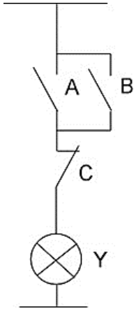

*Mynd 8: Rofarás.*

Hvernig breytum við þessari rofarás í rökrás? **A** hliðtengt við **B** er búið til með OR-hliði. Útkoman úr því er síðan margfölduð með $\overline{C}$ vegna raðtengingar **C** við hliðtenginguna að ofan. Útgangsjafnan verður $(A + B)\cdot\overline{C}$.

Rökrásin verður:

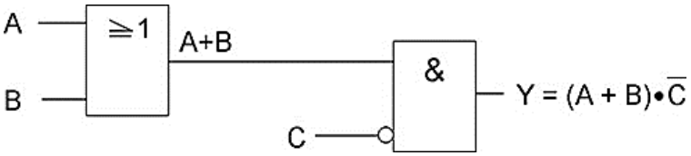

*Mynd 9: Rökrásin fyrir $Y = (A + B)\cdot\overline{C}$.*

Tökum annað dæmi um segulliðastýringu.

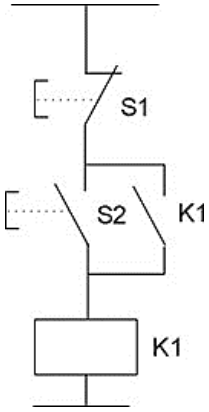

*Mynd 10: Stöðvun, ræsing og sjálfhelda.*

Þetta er hin dæmigerða stöðvunar-, ræsingar- og sjálfheldustýring (*stopp, start, sjálfhelda*). Útgangsjafnan er:

$$
K1 = \overline{S1}\cdot(K1 + S2)
$$

Rökrásin verður þá:

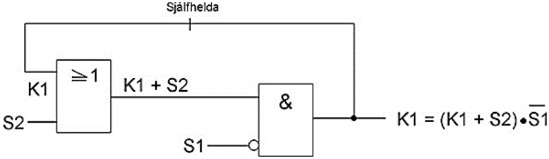

*Mynd 11: Rökrásin fyrir sjálfheldustýringuna.*

Sjáum að línan til baka frá K1 inn á OR-hliðið býr til sjálfhelduna. Þið lærið seinna í stýringaáföngum að það skiptir máli hvort S1 er lokuð eða opin snerta, þ.e. hvort neitun kemur á S1 eða ekki.

## 4. Rökrásum breytt í rofarásir

Þegar við breytum rökrásum í rofarásir þurfum við að skoða hvers konar tengingar hliðin búa til og hvernig hliðin tengjast síðan innbyrðis. Tökum dæmi um rökrás sem við höfum skoðað áður.

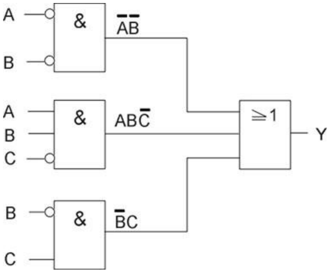

*Mynd 12: Rökrás úr dæmi 2 í kafla 1.*

OR-hliðið lengst til hægri er með þrjá innganga og býr því til þrjár hliðtengingar. Hver leggur fyrir sig í hliðtengingunni er búinn til af AND-hliði með ýmist tvo eða þrjá innganga. Útgangsjafnan er:

$$
Y = \overline{A}\,\overline{B} + AB\overline{C} + \overline{B}C
$$

Við þurfum í rauninni bara útgangsjöfnuna til að breyta í rofarás því hún segir allt sem segja þarf.

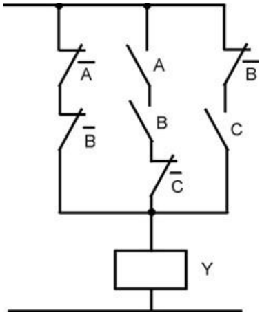

*Mynd 13: Rofarásin fyrir $Y = \overline{A}\,\overline{B} + AB\overline{C} + \overline{B}C$.*

## 5. Verkefni

**(Ekki nota bara svörin, það er sjálfsblekking.)**

**1.** Þrír menn, A, B og C, sitja í dómnefnd í hæfileikakeppni. Hver þeirra er með einn rofa sem hann þrýstir á ef hann samþykkir að atriðið komist áfram. Búið til rás með þremur inngöngum, A, B og C, sem kveikir á ljósi ef atriðið fær að minnsta kosti tvö atkvæði og kemst áfram (meirihluti ræður).

**2.** Finnið jöfnu útgangsins Y með hjálp Karnaugh-korts og teiknið einfölduðu rásina.

| A | B | C | Y |
|:-:|:-:|:-:|:-:|
| 0 | 0 | 0 | **1** |
| 0 | 0 | 1 | **1** |
| 0 | 1 | 0 | **0** |
| 0 | 1 | 1 | **1** |
| 1 | 0 | 0 | **1** |
| 1 | 0 | 1 | **1** |
| 1 | 1 | 0 | **0** |
| 1 | 1 | 1 | **0** |

| | $\overline{C}$ (0) | $C$ (1) |
|:-:|:-:|:-:|
| $\overline{A}\,\overline{B}$ (00) | | |
| $\overline{A}B$ (01) | | |
| $AB$ (11) | | |
| $A\overline{B}$ (10) | | |

$Y =$

**3.** Finnið jöfnu útgangsins Y með hjálp Karnaugh-korts og teiknið einfölduðu rásina.

| A | B | C | D | Y |
|:-:|:-:|:-:|:-:|:-:|
| 0 | 0 | 0 | 0 | **1** |
| 0 | 0 | 0 | 1 | **0** |
| 0 | 0 | 1 | 0 | **1** |
| 0 | 0 | 1 | 1 | **0** |
| 0 | 1 | 0 | 0 | **0** |
| 0 | 1 | 0 | 1 | **1** |
| 0 | 1 | 1 | 0 | **1** |
| 0 | 1 | 1 | 1 | **1** |
| 1 | 0 | 0 | 0 | **0** |
| 1 | 0 | 0 | 1 | **1** |
| 1 | 0 | 1 | 0 | **1** |
| 1 | 0 | 1 | 1 | **0** |
| 1 | 1 | 0 | 0 | **0** |
| 1 | 1 | 0 | 1 | **0** |
| 1 | 1 | 1 | 0 | **1** |
| 1 | 1 | 1 | 1 | **1** |

| | $\overline{C}\,\overline{D}$ (00) | $\overline{C}D$ (01) | $CD$ (11) | $C\overline{D}$ (10) |
|:-:|:-:|:-:|:-:|:-:|
| $\overline{A}\,\overline{B}$ (00) | | | | |
| $\overline{A}B$ (01) | | | | |
| $AB$ (11) | | | | |
| $A\overline{B}$ (10) | | | | |

$Y =$

**4.** Finnið útgangsjöfnuna út frá K-kortinu og teiknið rásina.

| | $\overline{C}$ (0) | $C$ (1) |
|:-:|:-:|:-:|
| $\overline{A}\,\overline{B}$ (00) | 1 | 1 |
| $\overline{A}B$ (01) | 0 | 1 |
| $AB$ (11) | 0 | 0 |
| $A\overline{B}$ (10) | 0 | 1 |

$Y =$

**5.** Finnið útgangsjöfnuna út frá K-kortinu og teiknið rásina.

| | $\overline{C}$ (0) | $C$ (1) |
|:-:|:-:|:-:|
| $\overline{A}\,\overline{B}$ (00) | 0 | 1 |
| $\overline{A}B$ (01) | 1 | 1 |
| $AB$ (11) | 0 | 1 |
| $A\overline{B}$ (10) | 0 | 1 |

$Y =$

**6.** Finnið útgangsjöfnuna út frá K-kortinu og teiknið rásina.

| | $\overline{C}\,\overline{D}$ (00) | $\overline{C}D$ (01) | $CD$ (11) | $C\overline{D}$ (10) |
|:-:|:-:|:-:|:-:|:-:|
| $\overline{A}\,\overline{B}$ (00) | 1 | 0 | 0 | 0 |
| $\overline{A}B$ (01) | 1 | 0 | 1 | 1 |
| $AB$ (11) | 1 | 0 | 1 | 1 |
| $A\overline{B}$ (10) | 0 | 1 | 1 | 0 |

$Y =$

**7.** Finnið útgangsjöfnuna út frá K-kortinu og teiknið rásina.

| | $\overline{C}\,\overline{D}$ (00) | $\overline{C}D$ (01) | $CD$ (11) | $C\overline{D}$ (10) |
|:-:|:-:|:-:|:-:|:-:|
| $\overline{A}\,\overline{B}$ (00) | 1 | 0 | 0 | 1 |
| $\overline{A}B$ (01) | 0 | 0 | 0 | 1 |
| $AB$ (11) | 0 | 0 | 1 | 1 |
| $A\overline{B}$ (10) | 1 | 0 | 1 | 1 |

$Y =$

**8.** Sýnið með Boole-algebru að hægt sé að einfalda

$$
\overline{A}\,\overline{B}\,\overline{C} + \overline{A}B\overline{C} + \overline{A}BC \quad\text{í}\quad \overline{A}\,\overline{C} + \overline{A}B
$$

**Munið** að þið megið nota stærð sem kemur fyrir í upphaflegu jöfnunni oftar en einu sinni. Það jafngildir því að nota sama reit oft í K-korti.

**9.** Einfaldið með Boole-algebru: $C + D\overline{C}$

**10.** Einfaldið $A\overline{B}C + A\overline{B}\,\overline{C} + \overline{A}\,\overline{B}\,\overline{C} + \overline{A}B\overline{C}$ með:

a) Boole-algebru\
b) K-korti

## 6. Svör

**1.**

| A | B | C | Y |
|:-:|:-:|:-:|:-:|
| 0 | 0 | 0 | **0** |
| 0 | 0 | 1 | **0** |
| 0 | 1 | 0 | **0** |
| 0 | 1 | 1 | **1** |
| 1 | 0 | 0 | **0** |
| 1 | 0 | 1 | **1** |
| 1 | 1 | 0 | **1** |
| 1 | 1 | 1 | **1** |

K-kort gefur:

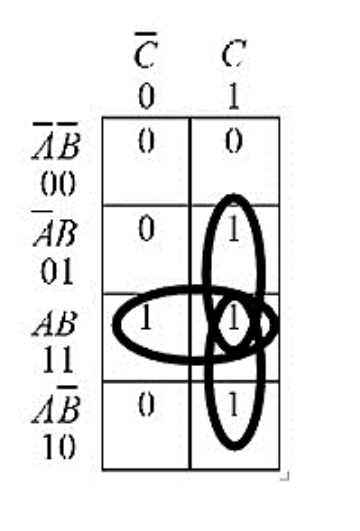

*Mynd 14: K-kort fyrir verkefni 1.*

Lausnin er: $Y = AB + AC + BC$

Rásin er:

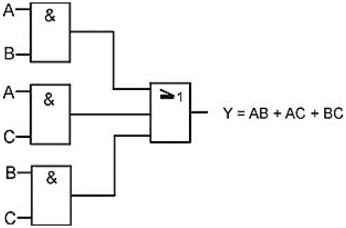

*Mynd 15: Rás fyrir $Y = AB + AC + BC$.*

**2.**

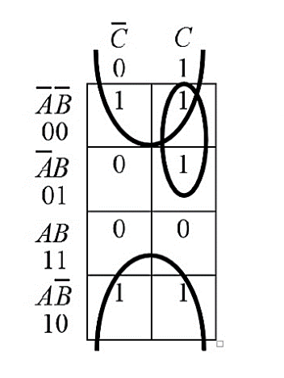

*Mynd 16: K-kort fyrir verkefni 2.*

Stóra lykkjan gefur $\overline{B}$; **A** og **C** breytast bæði. Lykkjan uppi hægra megin gefur $\overline{A}C$; **B** dettur út. Útgangsjafnan er:

$$
Y = \overline{B} + \overline{A}C
$$

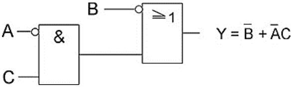

*Mynd 17: Rás fyrir $Y = \overline{B} + \overline{A}C$.*

**3.**

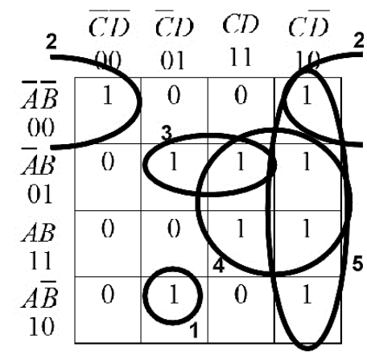

*Mynd 18: K-kort fyrir verkefni 3.*

- Lykkja nr. 1 parast ekki við neinn reit og einfaldast því ekkert. Útkoman er $A\overline{B}\,\overline{C}D$.
- Lykkja nr. 2 samanstendur af vinstri og hægri enda línu 1. Hún gefur $\overline{A}\,\overline{B}\,\overline{D}$.
- Lykkja nr. 3 gefur $\overline{A}BD$.
- Lykkja nr. 4 gefur $BC$.
- Lykkja nr. 5 gefur $C\overline{D}$.

Útgangsjafnan er:

$$
Y = A\overline{B}\,\overline{C}D + \overline{A}\,\overline{B}\,\overline{D} + \overline{A}BD + BC + C\overline{D}
$$

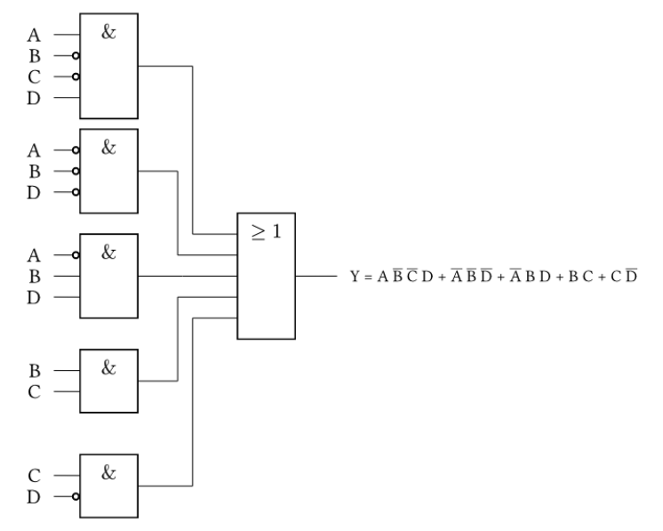

*Mynd 19: Rás fyrir verkefni 3.*

**4.**

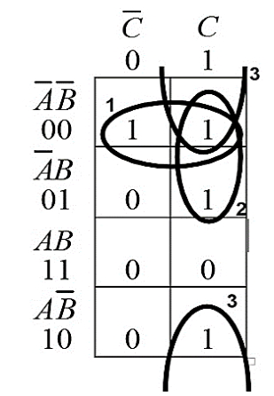

*Mynd 20: K-kort fyrir verkefni 4.*

- Lykkja 1 gefur $\overline{A}\,\overline{B}$.
- Lykkja 2 gefur $\overline{A}C$.
- Lykkja 3 gefur $\overline{B}C$.

Útgangsjafnan er $Y = \overline{A}\,\overline{B} + \overline{A}C + \overline{B}C$.

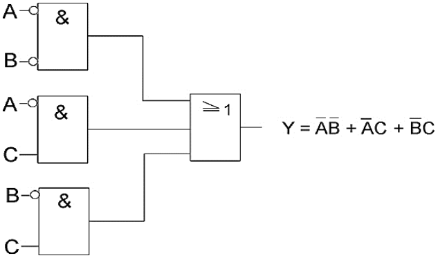

*Mynd 21: Rás fyrir verkefni 4.*

**5.**

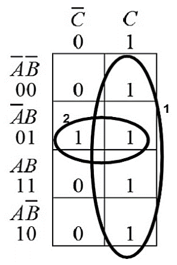

*Mynd 22: K-kort fyrir verkefni 5.*

- Lykkja 1 gefur $C$.
- Lykkja 2 gefur $\overline{A}B$.

Útgangsjafnan er $Y = C + \overline{A}B$.

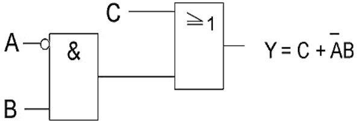

*Mynd 23: Rás fyrir verkefni 5.*

**6.**

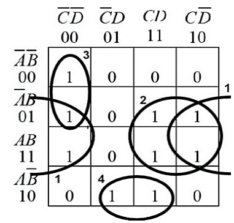

*Mynd 24: K-kort fyrir verkefni 6.*

- Lykkja 1 gefur $B\overline{D}$.
- Lykkja 2 gefur $BC$.
- Lykkja 3 gefur $\overline{A}\,\overline{C}\,\overline{D}$.
- Lykkja 4 gefur $A\overline{B}D$.

Útgangsjafnan er:

$$
Y = B\overline{D} + BC + \overline{A}\,\overline{C}\,\overline{D} + A\overline{B}D
$$

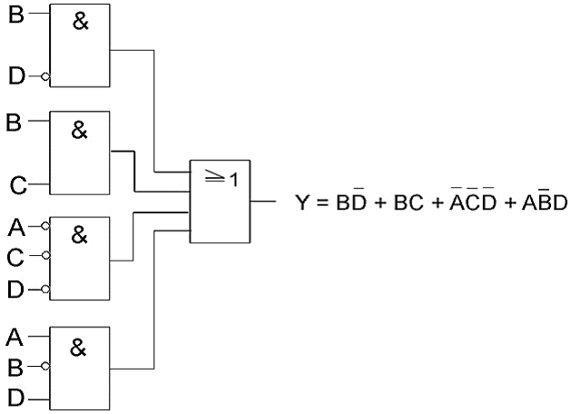

*Mynd 25: Rás fyrir verkefni 6.*

**7.**

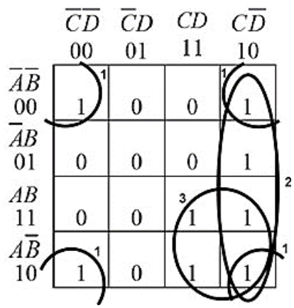

*Mynd 26: K-kort fyrir verkefni 7.*

- Lykkja 1 gefur $\overline{B}\,\overline{D}$.
- Lykkja 2 gefur $C\overline{D}$.
- Lykkja 3 gefur $AC$.

Útgangsjafnan er $Y = \overline{B}\,\overline{D} + C\overline{D} + AC$.

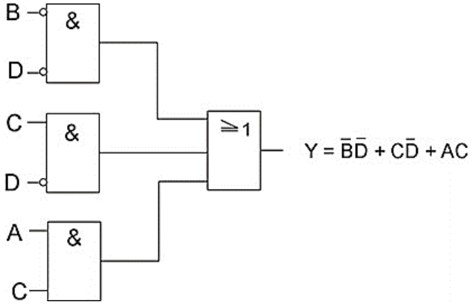

*Mynd 27: Rás fyrir verkefni 7.*

**8.** $\overline{A}\,\overline{B}\,\overline{C} + \overline{A}B\overline{C} + \overline{A}BC = \overline{A}\,\overline{C} + \overline{A}B$

Bætum $\overline{A}B\overline{C}$ við vinstri hliðina einu sinni enn. Það má samkvæmt reglu 1a ($A + A = A$):

$$
\overline{A}\,\overline{B}\,\overline{C} + \overline{A}B\overline{C} + \overline{A}B\overline{C} + \overline{A}BC = \overline{A}\,\overline{C}(\overline{B} + B) + \overline{A}B(\overline{C} + C) = \overline{A}\,\overline{C} + \overline{A}B
$$

**9.** $C + D\overline{C}$

Regla 9b segir: $A + \overline{A}B = A + B$. Samkvæmt henni er

$$
C + D\overline{C} = C + \overline{C}D = C + D
$$

**10.**

a) Boole-algebra:

$$
A\overline{B}C + A\overline{B}\,\overline{C} + \overline{A}\,\overline{B}\,\overline{C} + \overline{A}B\overline{C} = A\overline{B}(C + \overline{C}) + \overline{A}\,\overline{C}(\overline{B} + B) = A\overline{B} + \overline{A}\,\overline{C}
$$

b) K-kort:

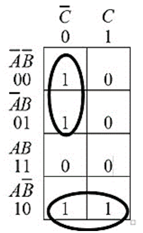

*Mynd 28: K-kort fyrir verkefni 10.*

Efri lykkjan gefur $\overline{A}\,\overline{C}$ og neðri lykkjan gefur $A\overline{B}$. Útgangsjafnan er $A\overline{B} + \overline{A}\,\overline{C}$ sem er sama og Boole-algebran gaf okkur.
